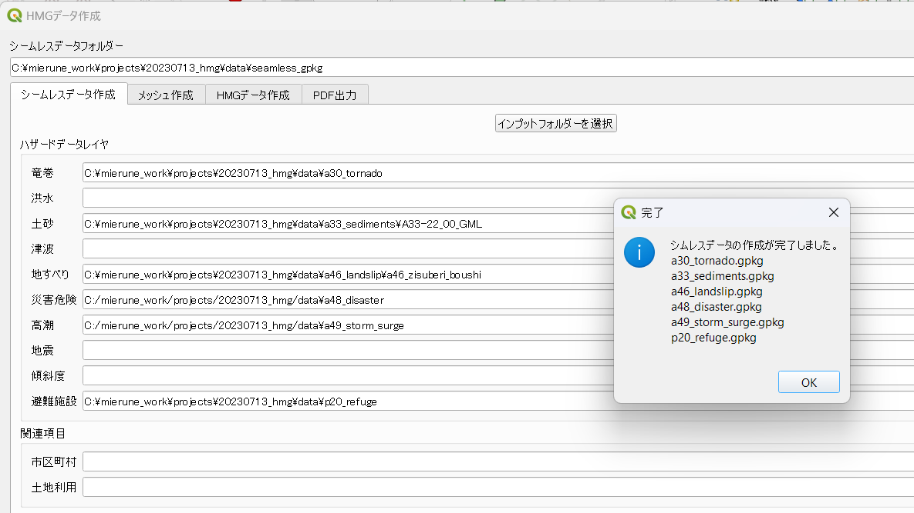
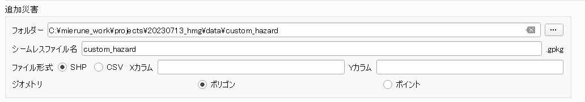
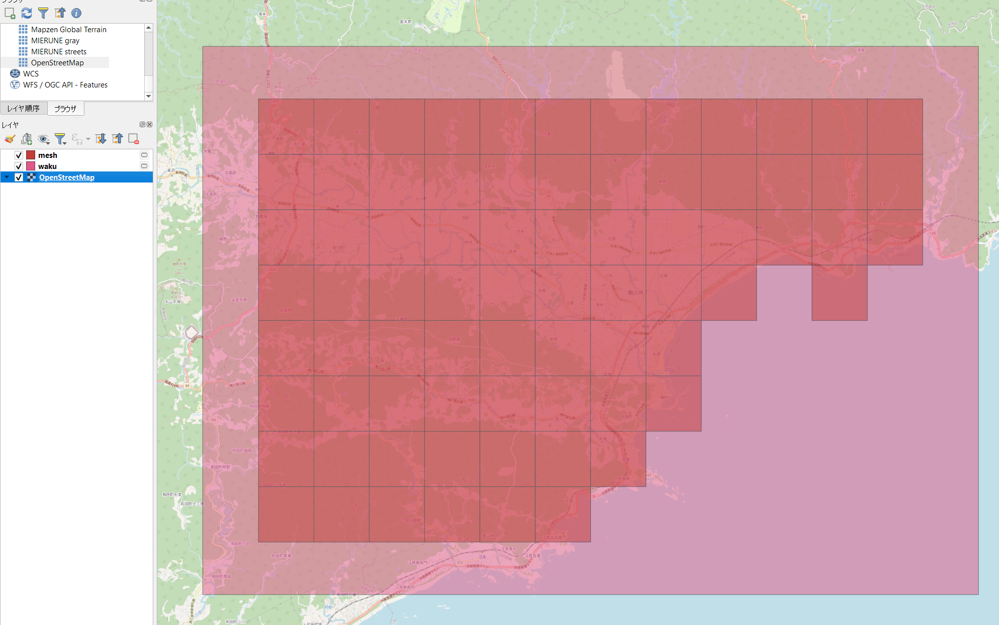
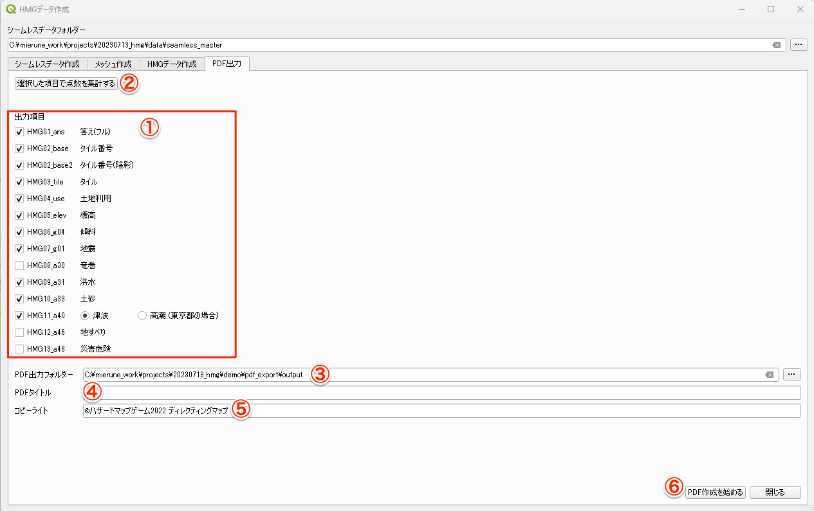

# 1. プログラム概要

## 前提条件
- 入出力ファイルディレクトリはファイルサーバでなく、QGISを実行するPCのローカル環境にあること。
- 動作環境
  - Windows11
  - QGIS 3.28 LRT

## プラグインのインストール
### ファイル
- 同梱のtcg-hmg-qgis.zipがアプリケーションファイルを圧縮したもので、PC内の任意の場所にダウンロードする。なお、zipファイルの解凍は不要である。
### 手順
以下の手順に従って、QGISにインストールする。

1. メニューバーの「プラグイン」>「プラグインの管理とインストール...」を押下し、プラグインウィンドウを展開する。

1. 左メニューの「ZIPからインストールする」を開き、「ZIPファイル」フォームにダウンロードした「tcg-hmg-qgis.zip」を指定して、「インストール」を押下する。

1. 再び、メニューバーの「プラグイン」>「プラグインの管理とインストール...」を押下し、プラグインウィンドウを展開する。左メニューの「インストール済み」を開き、今回インストールした「HMG DATA GENERATOR」の左側のチェックボックスにチェックを付ける。

1. インストールが正常に完了すると、メニューバーの「プラグイン」に「HMGデータ作成」が追加される。

## データ生成
### 手順
データは以下の手順で生成する。
1. シームレスデータ作成
1. メッシュの作成
1. ハザードマップゲームデータの作成
1. PDFとシェープファイルの出力

### 1. シームレスデータの作成
- この処理ではダウンロードしたデータを解凍し、統合した一つのジオパッケージファイルを作成する。
- 市区町村の場合、CSV形式で作成される。
- [参考: シームレスデータデータ作成処理の仕様](../spec/spec.md#1-シムレースデータ作成)

#### 準備
- 対象のデータをZIP形式でダウンロードする。
- [参考: 元データのダウンロード先](../spec/spec.md#12-入力データのダウンロードurl)

#### 画面構成と手順

- ① シームレスデータを出力するフォルダーを指定
  - 生成したシームレスデータを保存するフォルダーを指定する。
- ② レイヤーに応じた処理対象のZIPファイルを選択
  - レイヤーに応じて、「準備」でダウンロードした対象のデータをZIPファイルのまま指定する。
- ③ (任意) 自動フォルダー指定
  - 「インプットフォルダーを選択」を押下し、対象のZIPファイルが複数格納されたフォルダーを指定すると、ファイル名に応じて自動的にフォルダーを指定することができる。
  - なお、すでに指定されているフォルダーは上書きされる。
  - 各レイヤーに自動的に指定されるフォルダー名は以下の通りである。
    - ハザードレイヤ
      - a30_tornado : 竜巻
      - a31_flood : 洪水
      - a33_sediments : 土砂
      - a40_tsunami : 津波
      - a46_landslip : 地すべり
      - a48_disaster : 災害危険
      - a49_storm_surge : 高潮
      - b01_earthquake : 自身
      - g04_slope : 傾斜
      - p20_refuge : 避難施設
    - 関連項目
      - l03_landuse : 土地利用
      - japan_cities : 市区町村
    - seamless_gpkg : シームレスデータフォルダー

- ④ 処理開始ボタン
  - ②に指定したフォルダーの項目を処理される。
  - 処理には、データ量次第に1~30分かかる。
  - 処理が完了すると、作成したファイル名が表示される。
  

- ⑤ 追加災害 (任意)
  - カスタマイズ項目を作成する場合以下の項目を指定する。
    - フォルダー先（中身にZIPファイルが格納される。）
    - シームレスファイル名
    - ジオメトリの種類（ポリゴンかポイント）
    - ファイル形式 (CSV形式の場合、ジオメトリがポイントになり、XYのカラム指定が必要である。)
    

#### 出力ファイル
- 各項目のシームレスデータ（ジオパッケージ形式：.gpkg）は指定したフォルダーに保存される。

### ２. メッシュ作成
- 指定された市区町村の領域から、または指定された中心点座標から、HMGの対象エリアの枠と升（メッシュ）を作成する。

#### 前準備
- 指定されたシームレスフォルダーに、土地利用シームレスデータ（l03_landuse.gpkg）が格納されていることを確認する。
- 土地利用シームレスデータが存在しない場合、対象領域の調整を行わずに処理を進める。

#### 出力レイヤ

QGISプロジェクト
- 「waku」仮レイヤ : 対象エリアの枠 (A1サイズ)
- 「mesh」仮レイヤ : HMGデータの指定メッシュ

#### 画面構成と手順

- ① シームレスデータフォルダーを指定する。
  - 指定したシームレスフォルダーの中にjapan_cities.csvをUIの市区町村一覧に反映する。
  - japan_cities.csvが存在しない場合、プラグイン自体のdata/japancities.csvが指定される。
  - 指定したシームレスフォルダーに土地利用シームレスデータ（l03_landuse.gpkg）を利用して陸域率を計算する。
  - 土地利用シームレスデータが存在しない場合、陸域率を100%にして処理を進める。
- ② 市区町村で指定する場合
  - 「市区町村を指定」オプションをクリック。
  - 都道府県と市区町村を選択する。テキストボックスで漢字またはひらがなで検索可能。
  - 選択した市区町村の領域でA1の縮尺が自動で表示される。
  - メッシュ数は12x8で作成される。
  - 特定の縮尺とメッシュ数にする場合、中心点を指定してメッシュを作成することが可能（③）。
- ③ 中心点で指定する場合
  - 「中心点座標を指定」オプションにクリック。
  - 縮尺を指定。
    - デフォルト縮尺: 1:25000
  - 「地図から座標を選ぶ」ボタンを押して地図上で座標を指定。メッシュ境に重ならないように選択した中心点からメッシュの4分の1の距離でずらされる。
  - メッシュ数と向きを指定
    - 可能メッシュ数: 1-12 x 1-8
    - デフォルト向き：横
- ④ 設定履歴：指定した設定を履歴に保存可能
  - ログCSVを指定する。
    - 指定していない場合、プラグイン自体のdata/mesh_production_log.csvが指定される。
  - 設定を保存する場合、「ログ名を指定して保存」のテキストボックスにログ名を記入し、「履歴に保存する」ボタンを押す。対象CSVファイルにログが追加され、また、「履歴から選択」の一覧にも反映される。
  - 履歴設定を利用する場合、一覧からログを選択して設定が自動的にUIに反映される。
- ⑤ 陸域率を指定
  - 土地利用シームレスデータを参照し、指定された陸域率以下の領域を除外する。
  - デフォルト陸域率：10%
- ⑥ メッシュ作成ボタンを押すと、実行されて枠とメッシュが作成されます。

### ３. ハザードマップゲームデータの作成
- ハザードシームレスデータを利用して、「mesh」レイヤにハザードスコアとTCG方式の点数を計算。
- 各ハザードスコアの結果を分類し、地図とグラフで可視化する。
- 各ハザードに対して、「waku」レイヤにクリップしたシームレスデータを追加される。
- [参考: ハザードマップゲームデータの作成処理の仕様](../spec/spec.md#32-各種類の点数付与処理の仕様)

#### 前準備
- QGISプロジェクトに[3. メッシュ作成](3. メッシュ作成)で作成した「waku」と「mesh」レイヤ
- シームレスデータ
#### 出力レイヤ
- 「seamless_{災害名}」仮レイヤ: 「waku」にクリップされた各災害のシームレスデータ
- 「mesh_score」仮レイヤ: 各災害のリスクスコアとTCG方式の点数が付与されたメッシュ
- 「mesh_score_{災害名}」: 各災害のリスクスコアとTCG方式の点数が付与されたメッシュ（各災害確認用）

#### 画面構成と手順

- ① シームレスデータフォルダーを指定する。
- ② 追加災害（任意）: カスタマイズ災害のシームレスデータを作成した場合、以下の項目を指定する。
  - シームレスファイル名：指定したシームレスデータフォルダー内のカスタマイズデータファイル名（.gpkgを除く）
  - 陸域調整：スコアに陸域調整を行う場合は、チェックする。
  - HMG属性名：HMGデータのスコアのカスタマイズ属性名（8文字まで）
  - HMG計算方法: シームレスデータに値を使用する場合、「シームレス値属性名」を指定する。
- ③ HMGデータの作成を開始するボタンをクリックすると、ハザードスコアとTCG方式点数が計算される。

  - 処理が完了すると、以下の追加属性が表示され、各ハザードのmesh_scoreレイヤとシームレスレイヤが追加される。

  

- ④ グラフ可視化と地図可視化の対象レイヤ
  - ③の処理が完了すると、自動的に「mesh_score」に指定される。
- ⑤ 各ハザードのグラフ可視化と地図可視化の設定
  - a. 分類方法：
    - 標準偏差
    - TCG方式 ([参考: TCG方式計算ロジック](../spec/spec.md#2-ランク計算ロジック))
    - カスタム：d.で比率を編集する。
  - b. 最大分類数
  - c. 画像作成
    - グラフが表示され、設定した分類がグラフと地図に反映される。
    - ※ 分類方法と比率を編集してもリアルタイムで反映される。
  - d. 分類比率
    - カスタムの分類方法だけで編集できる。
- ⑥ 追加災害の分類（任意）
  - ②で設定したカスタマイズ災害でHMGデータを作成した場合、②で指定したHMG属性名がスコアの対象属性になる。
- ⑦ TCG方式の点数化を開始する
  - ④の対象レイヤに対してTCG方式を再計算する。

### 4. PDFとシェープファイル出力
- 以下の項目を選択し、A1サイズのPDFを出力する。
  - HMG01_ans : 災害点数合計と避難所数
    - 災害点数合計はHMG06~HMG13に選択した項目を合計する。
    - 災害点数合計は「mesh_score」レイヤに「hazard」属性が追加され、シェープファイル形式で出力される。
  - HMG02_base : タイル番号のみ
  - HMG02b_base2 : 地理院陰影地図が重なるタイル番号
  - HMG03_tile : タイルのみ（番号なし）
  - HMG04_use : 土地利用 
  - HMG05_elev : 地理院標高地図が重なるタイル番号
  - HMG06_g04 : 傾斜
    - seamless_slopeレイヤをグラデーションでシンボライズ
    - mesh_scoreレイヤのt_slope属性で点数を表示
  - HMG07_g01 : 地震
    - seamless_quakeレイヤをグラデーションでシンボライズ
    - mesh_scoreレイヤのt_quake属性で点数を表示
  - HMG08_a30 : 竜巻
    - seamless_tornadoレイヤをシンボライズ
    - mesh_scoreレイヤのt_tornado属性で点数を表示
  - HMG09_a31 : 洪水
    - seamless_floodレイヤをグラデーションでシンボライズ
    - mesh_scoreレイヤのt_flood属性で点数を表示
  - HMG10_a33 : 土砂
    - seamless_sedimentレイヤをシンボライズ
    - mesh_scoreレイヤのt_sediment属性で点数を表示
  - HMG11_a40 : 津波か高潮
    - seamless_tsunamiかseamless_surgeレイヤをグラデーションでシンボライズ
    - mesh_scoreレイヤのt_tsunamiかt_surge属性で点数を表示
  - HMG12_a46 : 地すべり
    - seamless_landslipレイヤをシンボライズ
    - mesh_scoreレイヤのt_landslip属性で点数を表示
  - HMG13_a48 : 災害危険
    - seamless_disasterレイヤをシンボライズ
    - mesh_scoreレイヤのt_disaster属性で点数を表示
- すべてのPDFには地理院地図が背景地図として使用される。

- [参考: 出力PDFの事例](../spec/spec.md#44-出力pdfの事例)

#### 前準備
- QGISプロジェクトに作成した「waku」レイヤ
- QGISプロジェクトにハザードマップゲームデータを作成した「mesh_score」レイヤ

#### 出力ファイル
- 選択したPDFファイル
  - PDF タイトルを指定した場合： {PDFタイトル}_HMG〇〇.pdf
  - PDF タイトルを指定しない場合は、タイムスタンプが付加される： {YYYYMMDDhhmmss}_HMG〇〇.pdf

#### 画面構成と手順

- ① 出力項目を選択
  - デフォルト項目：
    - HMG01
    - HMG02
    - HMG02b
    - HMG03
    - HMG04
    - HMG05
    - HMG06
    - HMG07
    - HMG09
    - HMG10
    - HMG11
- ② 災害点数を集計する
  - ①に選択した災害項目を集計し、「mesh_score」レイヤに`hazard`属性が付与される。
  - 災害点数の集計ランクも`rank`属性で付与される。
  - 処理後、点数のラベルは「label_score」レイヤに赤字で表示される。
- ③ PDF出力フォルダーを指定する
  - ①に選択する項目に保存される。
  - シェープファイルも指定したフォルダーに保存される。
- ④ PDFタイトル (任意) 
  - 指定された場合、PDFの左上にタイトルが表示される。
- ⑤ コピーライト
  - PDFの右下に表示される。
  - デフォルトは「©︎ハザードマップゲーム2022 ディレクティングマップ」

- ⑥ PDF作成を始めるボタンを押すと出力処理が実行される。
  - 選択項目数によっては数分で完了する。
  - 処理後、点数のラベルは合計点数が指定される。

  
