{To do : 目次}
## 1. プログラム概要

### 前提条件
- 入出力ファイルディレクトリは、ファイルサーバでなく、ローカル環境にあること
- 動作環境
  - Windows11
  - QGIS 3.28 LRT

### プラグインのインストール
同梱のtcg-hmg-qgis.zipがアプリケーション本体です。PC内の任意の場所に配置してください。zipファイルの解凍は不要です。

- 下記の手順でQGISにインストールします。

- 左メニューの「ZIPからインストールする」を開き、tcg-hmg-qgis.zipを選択しインストールします。
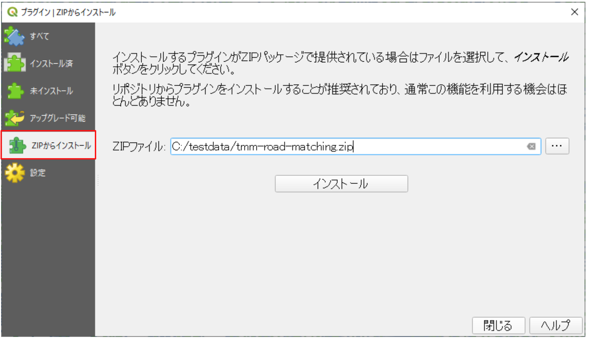

- 「インストール済み」を開き、「HMG DATA GENERATOR」をチェックします。
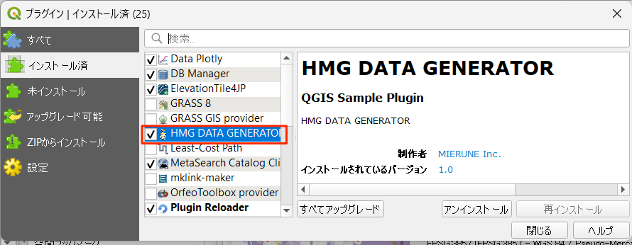

- インストールが完了すると、メニューバーの「プラグイン」に「HMGデータ作成」が追加されます。
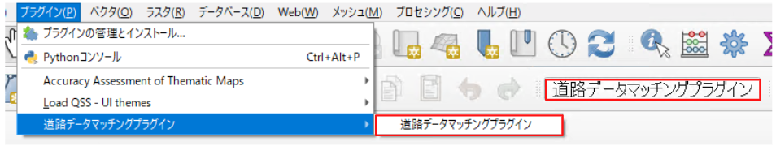

### 処理の流れ
処理の流れは4つで分けられる：
- ① シームレスデータ作成
- ② メッシュ作成
- ③ ハザードマップゲームデータの作成
- ④ PDFとシェープファイルの出力
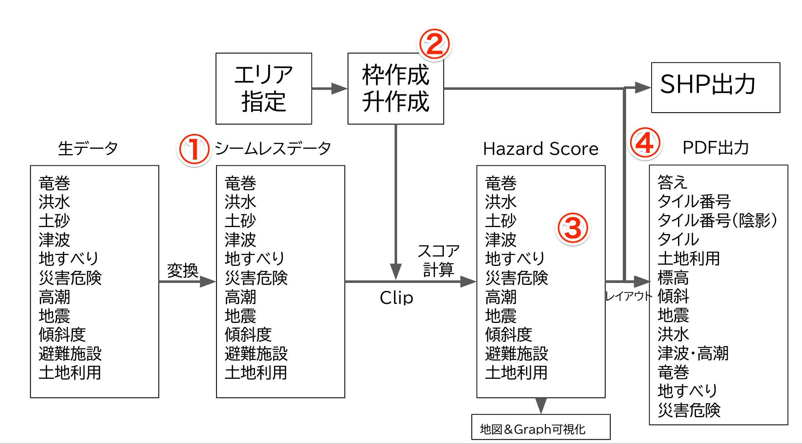

## 2. シームレスデータの作成
この処理がダウンロードしたデータを解凍し、まとめて一つのジオパッケージファイルを作成。
市区町村の場合、CSV形式で作成されます。
各項目の変換ロジック：{TODO: Spec Link}

### 前準備
- 対象データがZIP形式でダウンロードされます。
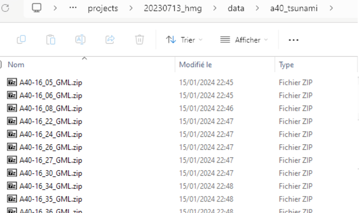
- TO DO : ダウンロード先URL

### 出力ファイル
- フォルダー指定した各項目のシームレスデータ(ジオパッケージ形式：.gpkg)
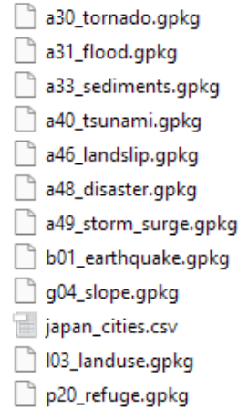

### 画面構成とその手順
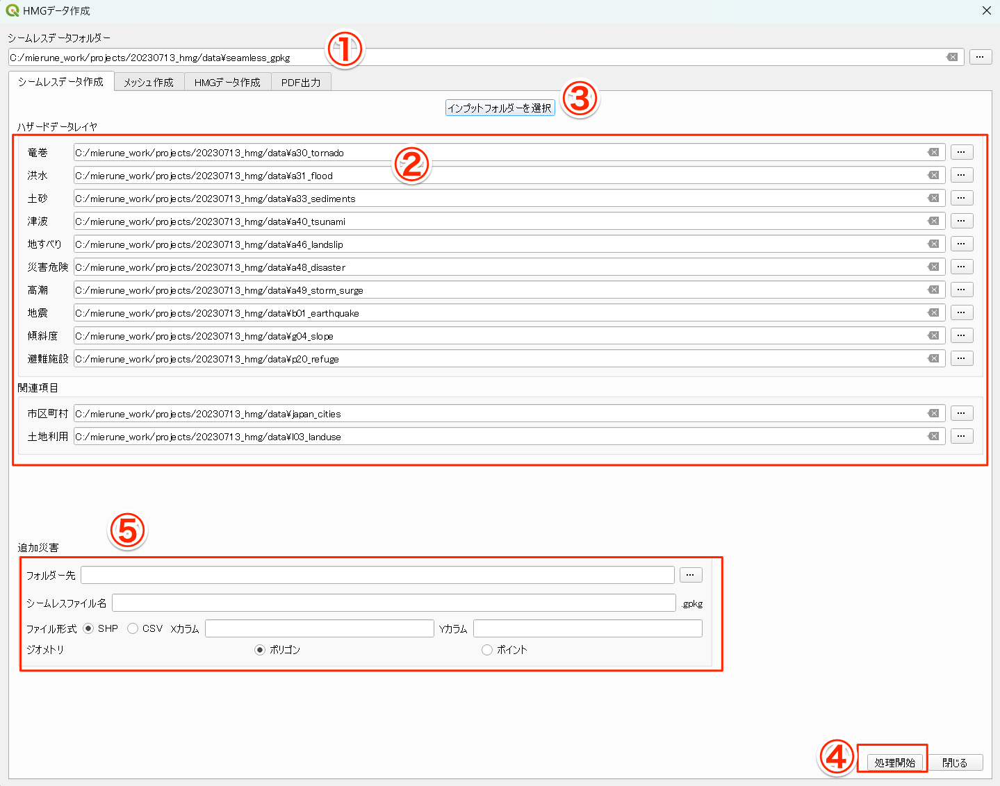
- ① 出力シームレスデータフォルダーを指定
- ② 入力データフォルダー
  - フォルダーを指定した項目だけが処理されてます。
  - 指定したフォルダーにZIPファイルが格納必須
- ③ まとめてフォルダーを選択 (任意)
  - 選択フォルダー内に下記のフォルダー構成の場合、各項目が自動で指定されます。
    - a30_tornado : 竜巻
    - a31_flood : 洪水
    - a33_sediments : 土砂
    - a40_tsunami : 津波
    - a46_landslip : 地すべり
    - a48_disaster : 災害危険
    - a49_storm_surge : 高潮
    - b01_earthquake : 自身
    - g04_slope : 傾斜
    - p20_refuge : 避難施設
    - l03_landuse : 土地利用
    - japan_cities : 市区町村
    - seamless_gpkg : アウトプットフォルダー
    ｛TODO：Data画像｝
- ④ 処理開始ボタン
  - ②に指定したフォルダーの項目を処理されます。
  - データ量によると1~30分かかります。
  - 処理が完了すると、作成したファイル名が表示されます。
  
- ⑤ 追加災害 (任意)
  - カスタマイズ項目を作成する場合以下の項目を指定してください。
    - フォルダー先（中身にZIPファイルが格納必須）
    - シームレスファイル名
    - ジオメトリの種類（ポリゴンかポイント）
    - ファイル形式 (CSV形式の場合、ジオメトリがポイントになり、XYのカラム指定が必須)
    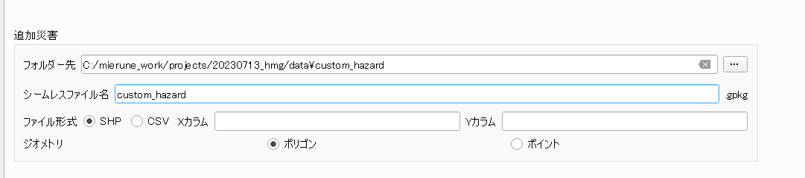

## 3. メッシュ作成
- 指定した市区町村の領域から、または指定した中心点座標からHMGの対象エリアの枠と升(メッシュ)を作成。

### 前準備
- 指定したシームレスフォルダーに土地利用シームレスデータ（l03_landuse.gpkg）が格納してること。
- 土地利用シームレスデータがない場合、対象領域調整せず処理がすすめる。

### 出力レイヤ

QGISプロジェクト
- 「waku」仮レイヤ : 対象エリアの枠 (A1サイズ)
- 「mesh」仮レイヤ : HMGデータの指定メッシュ

### 画面構成とその手順

- ① シームレスデータフォルダーを指定
  - 指定したシームレスフォルダーの中にjapan_cities.csvをUIの市区町村一覧に反映する。
  - japan_cities.csvが無い場合、プラグイン自体のdata/japancities.csvを指定される。
  - 指定したシームレスフォルダーに土地利用シームレスデータ（l03_landuse.gpkg）を利用して陸域率を計算。
  - 土地利用シームレスデータがない場合、陸域率を100%にして処理を進められる。
- ② 市区町村で指定する場合
  - 「市区町村を指定」オプションにクリック。
  - 都道府県と市区町村を選択。テキストボックスで漢字またはひらがなで検索可能。
  - 選択した市区町村の領域でA1の縮尺が自動で表示される。
  - メッシュ数が12x8で作成される。
  - 特定縮尺とメッシュ数にする場合、中心点を指定してメッシュを作成可能(③)
- ③ 中心点で指定する場合
  - 「中心点座標を指定」オプションにクリック。
  - 縮尺を指定。
    - デフォルト縮尺: 1:25000
  - 「地図から座標を選ぶ」ボタンを押して地図上で座標を指定。メッシュ境に重ならないように選択した中心点からメッシュの4分の1の距離でずらされる。
  - メッシュ数と向きを指定
    - 可能メッシュ数: 1~12 x 1~8
    - デフォルト向き：横
- ④ 設定履歴：指定した設定を履歴に保存可能
  - ログCSVを指定 
    - 指定してない場合、プラグイン自体のdata/mesh_production_log.csvを指定される。
  - 設定を保存する場合「ログ名を指定して保存」のテキストボックスにログ名を記入し、「履歴に保存する」ボタンに押す。対象CSVファイルにログを追加されるし、「履歴から選択」の一覧が反映される。
  - 履歴設定を利用する場合、「履歴から選択」の一覧にログを選択して設定が自動的にUIに反映される。
- ⑤ 陸域率を指定
  - 土地利用シームレスデータを見て指定した陸域率に数字以下を除外する。
  - デフォルト陸域率：10%
- ⑥ メッシュ作成ボタンを押すと実行されて枠とメッシュが作成される。

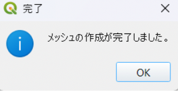

## 4. ハザードマップゲームデータの作成
- ハザードシームレスデータを使用して、作成した「mesh」レイヤにハザードスコアとTCG方式の点数を計算
- 各ハザードスコア結果を分類して地図とグラフで可視化
- 各ハザードに「waku」レイヤにクリップしたシームレスデータを追加
- 参考：計算ロジック{spec URL TODO}

### 前準備
- QGISプロジェクトに[3. メッシュ作成](3. メッシュ作成)で作成した「waku」と「mesh」レイヤ
- シームレスデータ
### 出力レイヤ
- 「seamless_{災害名}」仮レイヤ:「waku」にクリップされたの各災害シームレスデータもの
- 「mesh_score」仮レイヤ：各災害のリスクスコアとTCG方式点数が付いてるメッシュ
- 「mesh_score_{災害名}」：各災害のリスクスコアとTCG方式点数が付いてるメッシュ(各災害確認用)

### 画面構成と手順
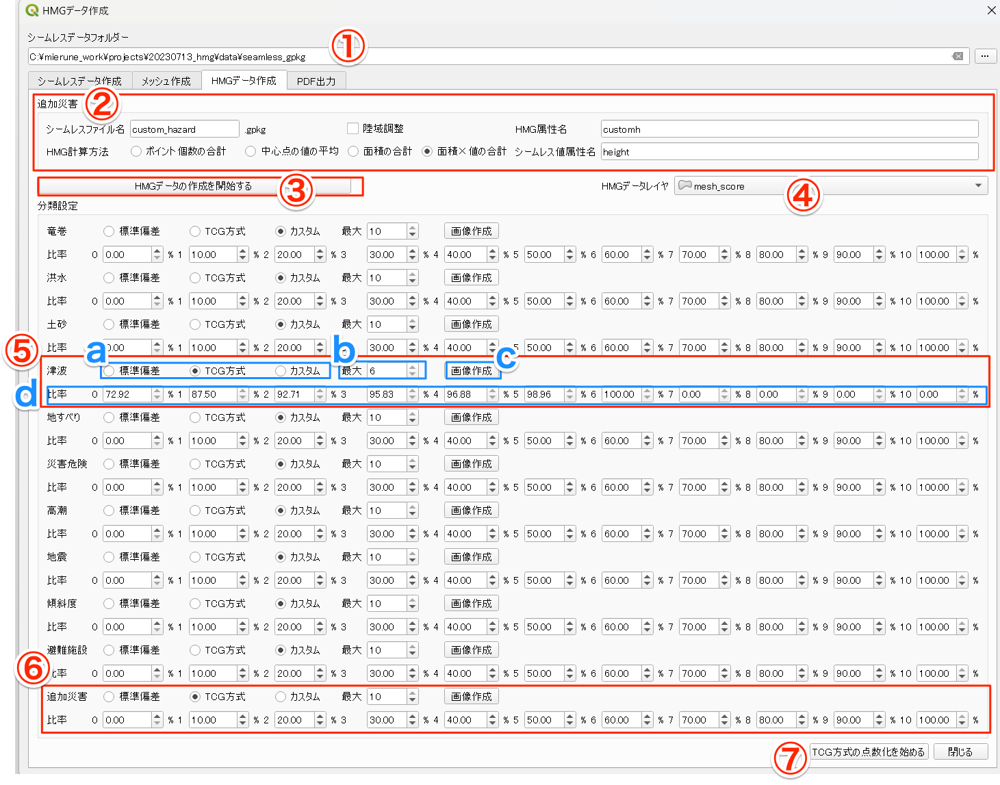
- ① シームレスデータフォルダーを指定
- ② 追加災害 (任意) カスタマイズ災害のシームレスデータを作成した場合以下の項目を指定
  - シームレスファイル名：指定したシームレスデータフォルダーのカスタマイズデータファイル名（.gpkgを抜ける）
  - 陸域調整：スコアに陸域調整する場合、チェックする
  - HMG属性名：HMGデータのスコアのカスタマイズ属性名：8文字まで
  - HMG計算方法: シームレスデータに値を使用する場合、「シームレス値属性名」を指定
- ③ HMGデータの作成を開始するボタンをクリックするとハザードスコアとTCG方式点数を計算される
  - 処理が終わったら以下の追加属性が表示されて、各ハザードのmesh_scoreレイヤとシームレスレイヤが追加される

  

- ④ グラフ可視化と地図可視化の対象レイヤ
  - ③の処理が完了すると、自動で「mesh_score」に指定される。
- ⑤ 各ハザードのグラフ可視化と地図可視化設定
  - a. 分類方法：
    - 標準偏差
    - TCG方式 (分類ロジック{TODO : Spec})
    - カスタム：d．に比率を編集する
  - b. 最大分類数
  - c. 画像作成
    - グラフが表示し、設定した分類をグラフと地図に反映
    - ※ 分類方法と比率を編集してもリアルタイムで反映される
  - d. 分類比率
    - カスタムの分類方法だけで編集可能

- ⑥ 追加災害の分類 (任意) 
  - ②に設定したカスタマイズ災害でHMGデータを作成した場合、②に指定したHMG属性名がスコアの対象属性
- ⑦ TCG方式の点数化を始める
  - ④の対象レイヤにTCG方式を再計算
## 5. PDFとシェープファイル出力
- 以下の項目を選択し、A1サイズのPDFを出力
  - HMG01_ans : 災害点数合計と避難所数
    - 災害点数合計はHMG06~HMG13に選択した項目を合計
    - 災害点数合計は「mesh_score」レイヤに「hazard」属性追加されてシェープファイル形式で出力される
  - HMG02_base : タイル番号のみ
  - HMG02b_base2 : 地理院陰影地図が重なるタイル番号
  - HMG03_tile : タイルのみ（番号なし）
  - HMG04_use : 土地利用 
  - HMG05_elev : 地理院標高地図が重なるタイル番号
  - HMG06_g04 : 傾斜
    - seamless_slopeレイヤをグラデーションでシンボライズ
    - mesh_scoreレイヤのt_slope属性で点数を表示
  - HMG07_g01 : 地震
    - seamless_quakeレイヤをグラデーションでシンボライズ
    - mesh_scoreレイヤのt_quake属性で点数を表示
  - HMG08_a30 : 竜巻
    - seamless_tornadoレイヤをシンボライズ
    - mesh_scoreレイヤのt_tornado属性で点数を表示
  - HMG09_a31 : 洪水
    - seamless_floodレイヤをグラデーションでシンボライズ
    - mesh_scoreレイヤのt_flood属性で点数を表示
  - HMG10_a33 : 土砂
    - seamless_sedimentレイヤをシンボライズ
    - mesh_scoreレイヤのt_sediment属性で点数を表示
  - HMG11_a40 : 津波か高潮
    - seamless_tsunamiかseamless_surgeレイヤをグラデーションでシンボライズ
    - mesh_scoreレイヤのt_tsunamiかt_surge属性で点数を表示
  - HMG12_a46 : 地すべり
    - seamless_landslipレイヤをシンボライズ
    - mesh_scoreレイヤのt_landslip属性で点数を表示
  - HMG13_a48 : 災害危険
    - seamless_disasterレイヤをシンボライズ
    - mesh_scoreレイヤのt_disaster属性で点数を表示
- すべてのPDFが地理院地図を背景地図で使用される

### 前準備
- QGISプロジェクトに[3. メッシュ作成](3. メッシュ作成)で作成した「waku」レイヤ
- QGISプロジェクトに[4. ハザードマップゲームデータの作成](4. ハザードマップゲームデータの作成)で作成した「mesh_score」レイヤ

### 出力ファイル
- 選択したPDFファイル
  - PDF タイトルを指定した場合： {PDFタイトル}_HMG〇〇.pdf
  - PDF タイトルを指定しない場合タイムスタンプを付ける： {YYYYMMDDhhmmss}_HMG〇〇.pdf

### 画面構成と手順
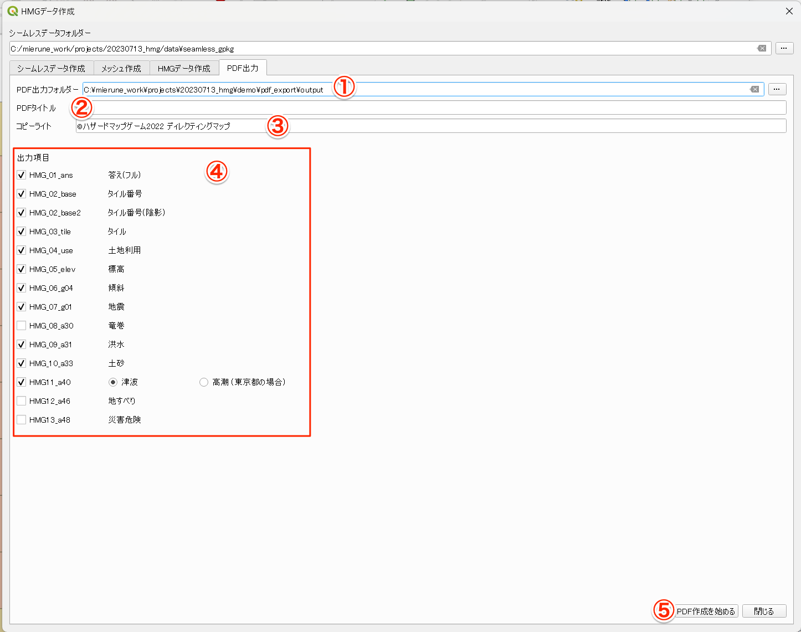
- ① PDF出力フォルダー
  - ④に選択する項目が指定したフォルダーに格納される
  - シェープファイルも指定したフォルダーに格納される
- ② PDFタイトル (任意) 
  - 指定する場合、PDFの左上にタイトルが表示される
- ③ コピーライト
  - PDFの右下に表示される
  - デフォルトは「©︎ハザードマップゲーム2022 ディレクティングマップ」
- ④ 出力項目を選択
  - デフォルトはHMG01,HMG02,HMG02b,HMG03,HMG04,HMG05,HMG06,HMG07,HMG09,HMG10,HMG11
- ⑤ PDF作成を始めるボタンを押すと出力処理を実行する
  - 選択項目数によると数分で完了する

  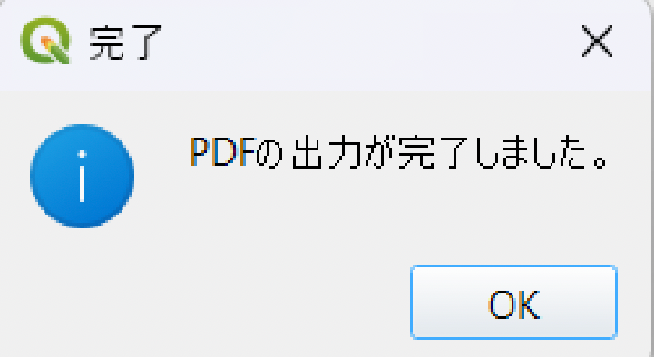

### 出力PDFの事例
「Sapporo」というのPDFタイトルを指定した出力事例

HMG01_ans : 災害点数合計と避難所数
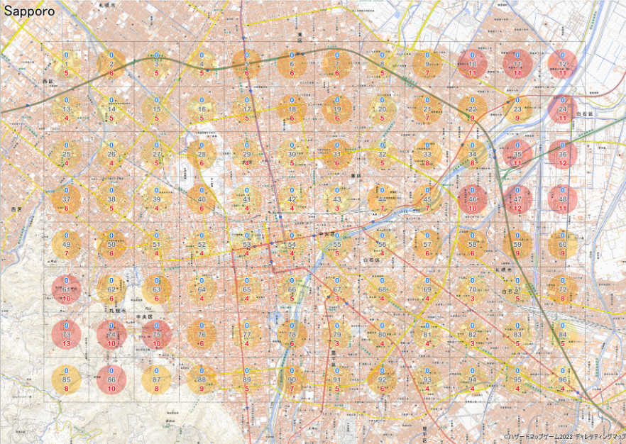

HMG02b_base2 : 地理院陰影地図が重なるタイル番号
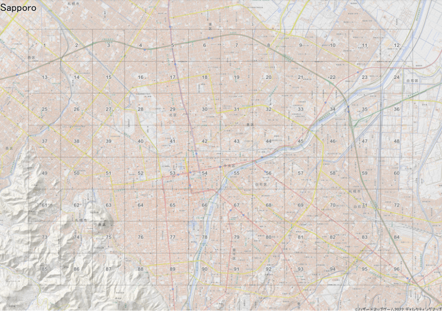

HMG04_use : 土地利用
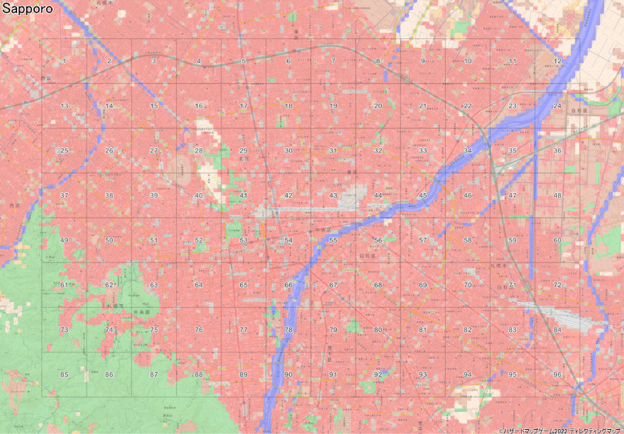

HMG05_elev : 地理院標高地図が重なるタイル番号
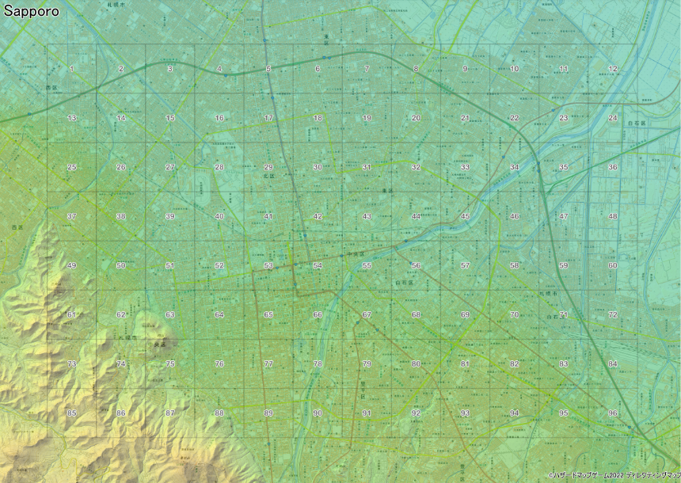

HMG07_g01 : 地震
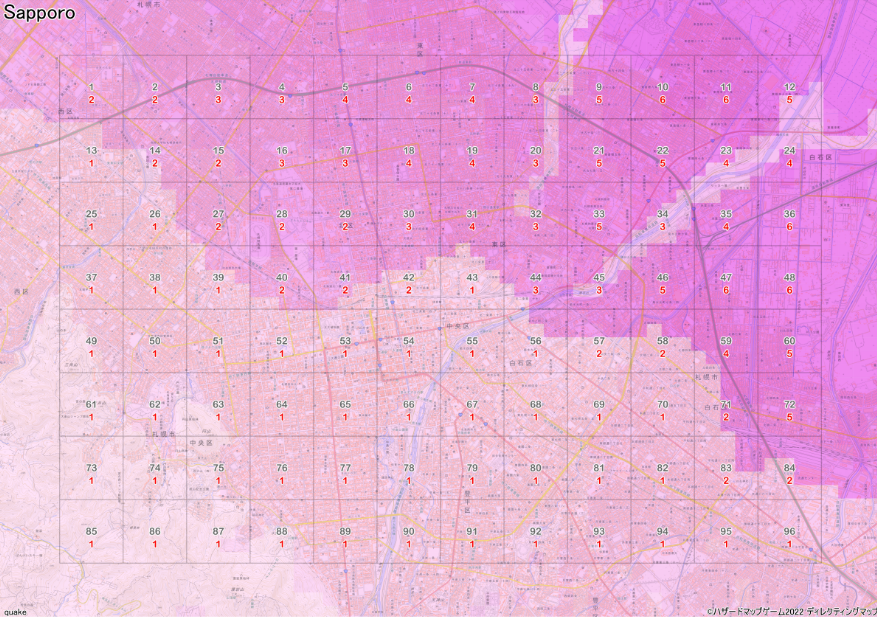

HMG09_a31 : 洪水
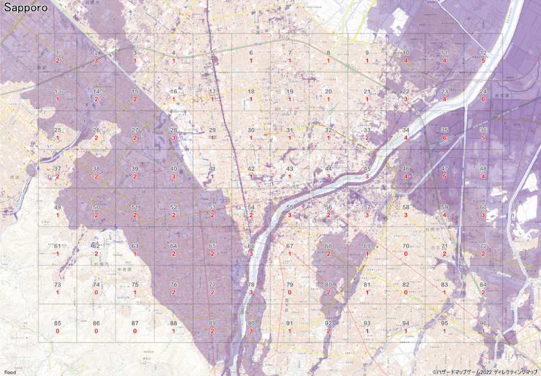