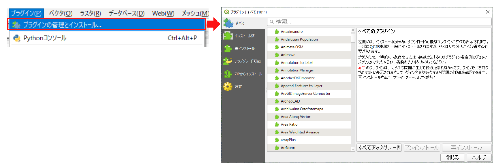
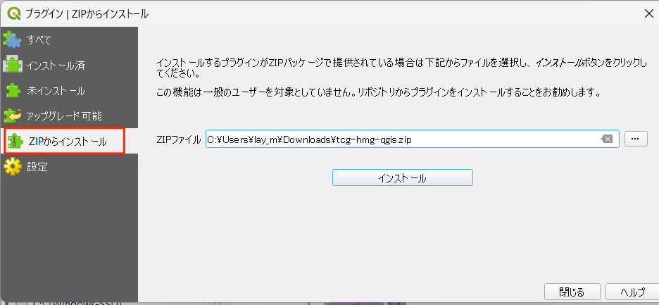
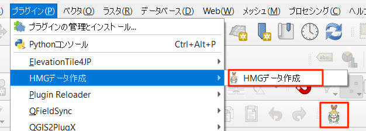
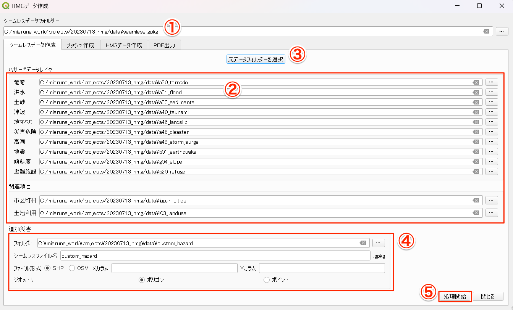
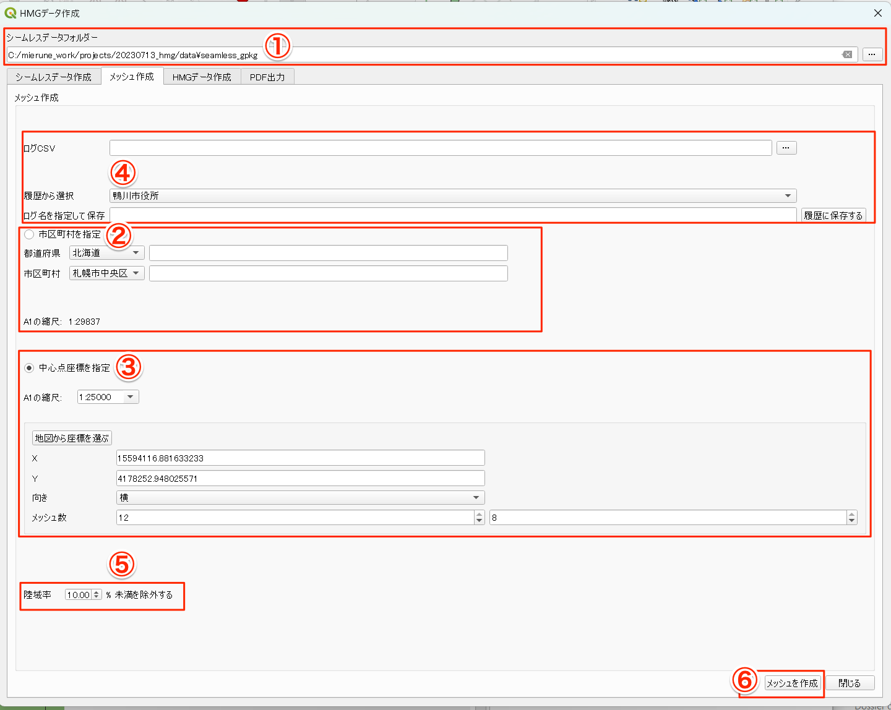
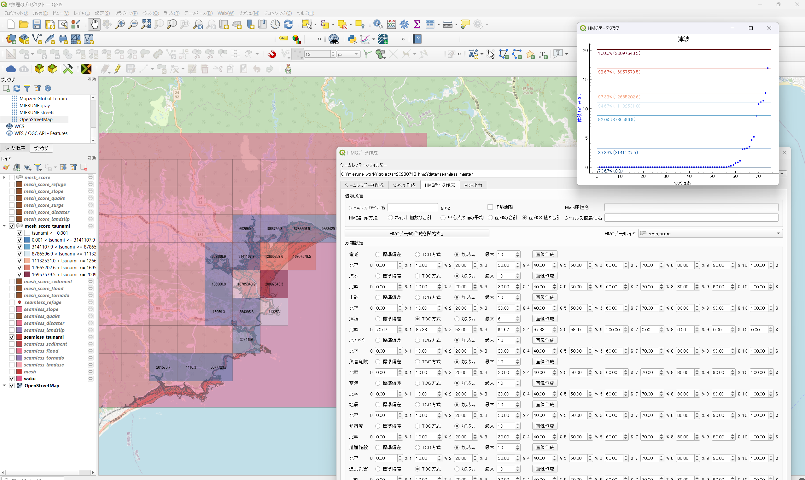
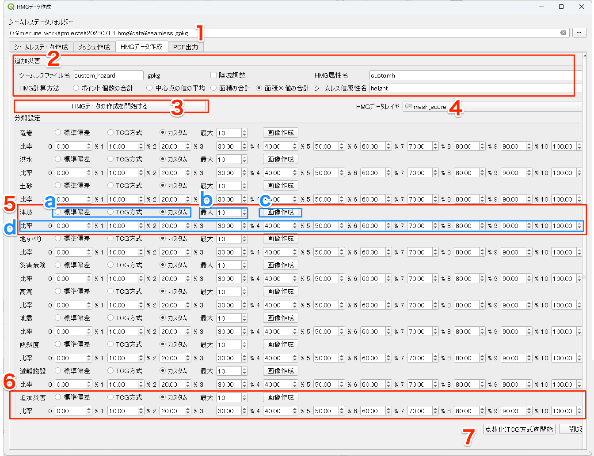
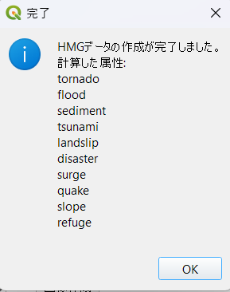

# 1. プログラム概要

## 前提条件
- 入出力ファイルディレクトリはファイルサーバでなく、QGISを実行するPCのローカル環境にあること。
- 動作環境
  - Windows11
  - QGIS 3.28 LTR

## プラグインのインストール
### ファイル
- 同梱のtcg-hmg-qgis.zipがアプリケーションファイルを圧縮したもので、PC内の任意の場所にダウンロードする。なお、zipファイルの解凍は不要である。
### 手順
以下の手順に従って、QGISにインストールする。

1. メニューバーの「プラグイン」>「プラグインの管理とインストール...」を押下し、プラグインウィンドウを展開する。

1. 左メニューの「ZIPからインストールする」を開き、「ZIPファイル」フォームにダウンロードした「tcg-hmg-qgis.zip」を指定して、「インストール」を押下する。

1. 再び、メニューバーの「プラグイン」>「プラグインの管理とインストール...」を押下し、プラグインウィンドウを展開する。左メニューの「インストール済み」を開き、今回インストールした「HMG DATA GENERATOR」の左側のチェックボックスにチェックを付ける。

1. インストールが正常に完了すると、メニューバーの「プラグイン」に「HMGデータ作成」が追加される。

## データ生成
### 手順
データは以下の手順で生成する。
1. シームレスデータ作成
1. メッシュの作成
1. ハザードマップゲーム(HMG)データの作成
1. PDFとシェープファイルの出力

### 1. シームレスデータの作成
- この処理ではダウンロードしたデータを解凍し、統合した一つのジオパッケージファイルを作成する。
- 市区町村の場合、CSV形式で作成される。
- [参考: シームレスデータデータ作成処理の仕様](../spec/spec.md#1-シムレースデータ作成)

    #### 準備
    - 対象のデータをZIP形式でダウンロードする。
    - [参考: 元データのダウンロード先](../spec/spec.md#12-入力データのダウンロードurl)

    

    #### 画面構成と手順
    
    1. シームレスデータを出力するフォルダーを指定
        - 生成したシームレスデータを保存するフォルダーを指定する。
    1. 項目に応じた処理対象のフォルダーを選択
        - 項目に応じて、「準備」でダウンロードした対象のデータをZIPファイルのまま指定する。
    1. (任意) 自動フォルダー指定
        - 「元データフォルダーを選択」を押下し、対象のZIPファイルが複数格納されたフォルダーを指定すると、ファイル名に応じて自動的にフォルダーを指定することができる。
        - なお、すでに指定されているフォルダーは上書きされる。
        - 各項目に自動的に指定されるフォルダー名は以下の通りである。
          - ハザードレイヤ
            - a30_tornado : 竜巻
            - a31_flood : 洪水
            - a33_sediments : 土砂
            - a40_tsunami : 津波
            - a46_landslip : 地すべり
            - a48_disaster : 災害危険
            - a49_storm_surge : 高潮
            - b01_earthquake : 地震
            - g04_slope : 傾斜
            - p20_refuge : 避難施設
          - 関連項目
            - l03_landuse : 土地利用
            - japan_cities : 市区町村
          - seamless_gpkg : シームレスデータフォルダー

    1. (任意) 追加災害
        - 追加災害を指定することでスコアの算出に加えることができる。
          - フォルダー：ZIPファイル
          - シームレスファイル名：出力するファイル名
          - ファイル形式：SHP or CSV
              - CSV形式の場合、ジオメトリがポイントになり、Xカラム・Yカラムの指定が必要である。
          - ジオメトリの種類：ポリゴン or ポイント
          

    1. 処理開始ボタン
        - 「項目に応じた処理対象のZIPファイルを選択」で指定したフォルダーの項目ごとに処理を行う。
        - 処理時間は実行PCスペック・データ量に応じて、1~30分かかる。
        - 処理が完了すると、ポップアップに完了のメッセージと作成したファイル名が表示される。
        

    #### 出力ファイル
    - 処理が正常に完了すると各項目のシームレスデータが、指定したフォルダーにジオパッケージ形式（.gpkg）で保存される。

      

### ２. メッシュ作成
- 指定した市区町村の領域、または指定された中心点座標から、HMGの対象エリアの枠と升（メッシュ）を作成する。
- その他にも、以前設定した場合はログファイルから範囲を指定することもできる。

    #### 前準備
    - 「シームレスデータ作成」において、土地利用のファイルを指定した場合は、出力された土地利用シームレスデータ（l03_landuse.gpkg）が、指定したシームレスデータフォルダーに格納されていることを確認する。
    - 土地利用シームレスデータを使用しない場合は、対象領域の調整を行わずに処理を進める。

    #### 画面構成と手順
    
    1. 作成したシームレスデータのフォルダーを指定
        - 指定したシームレスデータフォルダーの中に市区町村定義ファイル（japan_cities.csv）が存在する場合は、「市区町村を指定」の市区町村プルダウンに一覧が表示される。
        ただし、市区町村定義ファイル（japan_cities.csv）が存在しない場合は、プラグインファイルのdata/japancities.csvの内容がデフォルトで表示される。
        - 指定したシームレスデータフォルダーに土地利用シームレスデータ（l03_landuse.gpkg）が存在する場合は、陸域率（区画の陸の割合）の計算に使用することができる。
        ただし、土地利用シームレスデータ（l03_landuse.gpkg）が存在しない場合、陸域率を100%にして処理を進める。
    1. 市区町村から指定する場合
        - 「市区町村を指定」にチェックを付ける。
        - 都道府県と市区町村をそれぞれ選択する。テキストボックスでは、漢字またはひらがなで検索することが可能となっている。
        - 選択した市区町村の領域で「A1の縮尺」が自動で算出される。
        - メッシュ数は12x8となっている。
        - 特定の縮尺とメッシュ数を指定する場合、中心点座標から指定する必要がある（③）。
    1. 中心点から指定する場合
        - 「中心点座標を指定」にチェックをつける。
        - 縮尺を指定する。
          - 「A1の縮尺」から任意の縮尺を選択する。デフォルトの縮尺は「1:25000」となっている。
        - 中心座標点を指定する。
          - 「地図上で指定」ボタンを押下し、表示された地図上で中心点となる座標を指定する。
          指定した座標を中心としたメッシュが作成される。
        - メッシュ数と向きを指定する。
          - 設定可能なメッシュ数は、横:1-12, 縦:1-8となっている。
          - 向きはデフォルトで横になっている。
    1. 履歴から設定の反映・設定の保存
        - 「ログ CSV」に使用したいログが保存された、またはログを保存したいCSVファイルを指定する。
        CSVファイルを指定しない場合、プラグインファイルのdata/mesh_production_log.csvが指定される。
        - 履歴から設定の反映する場合
          - 「ログ CSV」で指定した、もしくはデフォルトのCSVファイルに保存された設定を「履歴から指定」で選択すると、設定が自動的に各フォームに反映される。
        - 設定を保存する場合
          - 「ログ名を指定して保存」のテキストボックスに設定のログ名を記入し、「履歴に保存する」ボタンを押下すると、指定またはデフォルトのCSVファイルに設定が保存される。「履歴から指定」の一覧から保存されたことが確認できる。
    1. 陸域率を指定
        - 土地利用シームレスデータを参照し、指定された陸域率（領域内の陸の割合）未満の領域を除外する。
        - デフォルト陸域率は10%となっている。
    1. メッシュ作成ボタンを押すと、実行されて枠レイヤーとメッシュレイヤーが作成される。作成に成功した場合は「完了」ポップアップと地図上にメッシュが表示される。

        
        

    #### 出力レイヤ
    - 「waku」仮レイヤ : 対象エリアの枠 (A1サイズ)
    - 「mesh」仮レイヤ : HMGデータの指定メッシュ

### ３. ハザードマップゲーム(HMG)データの作成
- シームレスデータを利用して、「mesh」レイヤの区画ごとにハザードスコアとTCG方式の点数を算出する。
- 各区画ごとに災害スコアの結果を、地図上のレイヤーとグラフで可視化する。
- 「waku」レイヤの区画ごとに各種災害のスコアを追加する。
- [参考: ハザードマップゲームデータの作成処理の仕様](../spec/spec.md#32-各種類の点数付与処理の仕様)

  

    #### 前準備
    - 上記の手順で以下のデータが作成済みであることを確認する。
      1. シームレスデータ
      1. 「waku」と「mesh」レイヤー

    #### 画面構成と手順
    
    1. シームレスデータフォルダーを指定する。
    1. (任意) 追加災害のシームレスデータを作成した場合、以下の項目を指定する。
        - シームレスファイル名：指定したシームレスデータフォルダー内の追加災害のファイル名を選択する。
        - 陸域調整：スコアに陸域調整を行う場合は、チェックする。
        - HMG属性名：HMGデータのスコアのカスタマイズ属性名（8文字まで）を入力する。
        - HMG計算方法: シームレスデータに値を使用する場合、「シームレス値属性名」を指定する。
    1. 「HMGデータの作成を開始する」ボタンを押下し、災害スコアを計算する。

        - 処理が完了すると、「完了」ポップアップに追加属性が表示され、メッシュの各区域ごとに災害スコアを格納したmesh_scoreレイヤーとシームレスデータレイヤーが追加される。

          

    1. 「HMGデータレイヤ」に各区域ごとの災害スコアが定義されたレイヤーを指定する。
        - デフォルトでは、3で作成したレイヤー「mesh_score」が自動的に指定される。
    1. 各災害のグラフ可視化と地図可視化を設定する。
        1. 分類方法：
            - 標準偏差
            - TCG方式 ([参考: TCG方式計算ロジック](../spec/spec.md#2-ランク計算ロジック))
            - カスタム：d.で比率を編集する。
        1. 最大分類数
        1. 画像作成
            - グラフが表示され、設定した分類がグラフと地図に反映される。
            - ※ 分類方法と比率を編集してもリアルタイムで反映される。
        1. 分類比率
            - カスタムの分類方法だけで編集できる。
    1. (任意) 追加災害の分類を設定する。
        - 設定した追加災害でHMGデータを作成した場合、指定したHMG属性名がスコアの対象属性になる。
    1. TCG方式の点数化を開始する。
        - 指定した「HMGデータレイヤ」に対してTCG方式を再計算する。

    #### 出力レイヤ
    - 以下レイヤーが出力される
        - 「seamless_{災害名}」仮レイヤ: 「waku」にクリップされた各災害のシームレスデータ
        - 「mesh_score」仮レイヤ: 各災害のリスクスコアとTCG方式の点数が付与されたメッシュ
        - 「mesh_score_{災害名}」: 各災害のリスクスコアとTCG方式の点数が付与されたメッシュ（各災害確認用）

### 4. PDFとシェープファイル出力
- 以下の項目を選択し、A1サイズのPDFを出力する。
  - HMG01_ans : 災害点数合計と避難所数
    - 災害点数合計はHMG06~HMG13に選択した項目を合計する。
    - 災害点数合計は「mesh_score」レイヤに「hazard」属性が追加され、シェープファイル形式で出力される。
  - HMG02_base : タイル番号のみ
  - HMG02b_base2 : 地理院陰影地図が重なるタイル番号
  - HMG03_tile : タイルのみ（番号なし）
  - HMG04_use : 土地利用 
  - HMG05_elev : 地理院標高地図が重なるタイル番号
  - HMG06_g04 : 傾斜
    - seamless_slopeレイヤをグラデーションでシンボライズ
    - mesh_scoreレイヤのt_slope属性で点数を表示
  - HMG07_g01 : 地震
    - seamless_quakeレイヤをグラデーションでシンボライズ
    - mesh_scoreレイヤのt_quake属性で点数を表示
  - HMG08_a30 : 竜巻
    - seamless_tornadoレイヤをシンボライズ
    - mesh_scoreレイヤのt_tornado属性で点数を表示
  - HMG09_a31 : 洪水
    - seamless_floodレイヤをグラデーションでシンボライズ
    - mesh_scoreレイヤのt_flood属性で点数を表示
  - HMG10_a33 : 土砂
    - seamless_sedimentレイヤをシンボライズ
    - mesh_scoreレイヤのt_sediment属性で点数を表示
  - HMG11_a40 : 津波か高潮
    - seamless_tsunamiかseamless_surgeレイヤをグラデーションでシンボライズ
    - mesh_scoreレイヤのt_tsunamiかt_surge属性で点数を表示
  - HMG12_a46 : 地すべり
    - seamless_landslipレイヤをシンボライズ
    - mesh_scoreレイヤのt_landslip属性で点数を表示
  - HMG13_a48 : 災害危険
    - seamless_disasterレイヤをシンボライズ
    - mesh_scoreレイヤのt_disaster属性で点数を表示
- すべてのPDFには地理院地図が背景地図として使用される。

- [参考: 出力PDFの事例](../spec/spec.md#44-出力pdfの事例)

    #### 前準備
    - 上記の手順で以下のデータが作成済みであることを確認する。
      1. 「waku」レイヤー
      1. 「mesh_score」レイヤー

    #### 画面構成と手順
    
    1. 出力項目を選択する。
        - 以下の項目はデフォルトで選択されている。
          - HMG01
          - HMG02
          - HMG02b
          - HMG03
          - HMG04
          - HMG05
          - HMG06
          - HMG07
          - HMG09
          - HMG10
          - HMG11
    1. 災害点数を集計する。
        - 選択した出力項目で災害スコアを集計し、「mesh_score」レイヤに`hazard`属性を付与する。
        - 災害点数の集計ランクも`rank`属性で付与される。
        - 処理後、点数のラベルは「label_score」レイヤに赤字で表示される。
    1. PDF出力先のフォルダーを指定する。
        - 選択した出力項目のPDF・シェープファイルが生成され、指定したフォルダーに保存される。
    1. (任意) PDFタイトル
        - 指定された場合、PDFの左上にタイトルが表示される。
    1. コピーライト
        - PDFの右下に表示される。
        - デフォルトは「©︎ハザードマップゲーム2022 ディレクティングマップ」である。

    1. PDF出力開始ボタンを押すと出力処理が実行される。
        - 選択項目数によっては数十秒-数分で完了する。
        - 処理完了後、点数のラベルは合計点数が指定される。

          

    #### 出力ファイル
    - 選択したPDFファイル
      - PDF タイトルを指定した場合： {PDFタイトル}_HMG〇〇.pdf
      - PDF タイトルを指定しない場合は、タイムスタンプが付加される： {YYYYMMDDhhmmss}_HMG〇〇.pdf

