この資料が処理のロジックがまとめる。
このツールの処理を4つに分かれる：
- ① シームレスデータ作成
- ② メッシュの作成
- ③ ハザードマップゲームデータの作成
- ④ PDFとシェープファイルの出力

## 1. シムレースデータ作成

### 1.1. 入力データ構成

- フォルダー構成によって、各項目が自動的に指定される。
- フォルダー名を変更可能が、UIに個別で指定必要がある。

### 1.2. 入力データのダウンロードURL
各項目の参考なダウンロードURL。
バージョンが変わる可能性がある。
ZIP形式で上記のフォルダーへダウンロードし、解凍が不要。

| コード | 項目名  | 内容           | ダウンロード先                                                                                                                                  | 備考          |
| --- | ---- | ------------ | ---------------------------------------------------------------------------------------------------------------------------------------- | ----------- |
| A30 | 竜巻   | 竜巻等の突風       | [https://nlftp.mlit.go.jp/ksj/gml/datalist/KsjTmplt-A30b.html](https://nlftp.mlit.go.jp/ksj/gml/datalist/KsjTmplt-A30b.html)             |             |
| A31 | 洪水   | 洪水浸水想定区域     | [https://nlftp.mlit.go.jp/ksj/gml/datalist/KsjTmplt-A31-v2_2.html](https://nlftp.mlit.go.jp/ksj/gml/datalist/KsjTmplt-A31-v2_2.html)     |             |
| A33 | 土砂   | 土砂災害警戒区域     | [https://nlftp.mlit.go.jp/ksj/gml/datalist/KsjTmplt-A33-v1_4.html](https://nlftp.mlit.go.jp/ksj/gml/datalist/KsjTmplt-A33-v1_4.html)     |             |
| A40 | 津波   | 津波浸水想定区域     | [https://nlftp.mlit.go.jp/ksj/gml/datalist/KsjTmplt-A40-v2_1.html](https://nlftp.mlit.go.jp/ksj/gml/datalist/KsjTmplt-A40-v2_1.html)     |             |
| A46 | 地すべり | 地すべり防止区域     | [https://nlftp.mlit.go.jp/ksj/gml/datalist/KsjTmplt-A46-v1_1.html](https://nlftp.mlit.go.jp/ksj/gml/datalist/KsjTmplt-A46-v1_1.html)     |             |
| A48 | 災害危険 | 災害危険区域       | [https://nlftp.mlit.go.jp/ksj/gml/datalist/KsjTmplt-A48-v1_1.html](https://nlftp.mlit.go.jp/ksj/gml/datalist/KsjTmplt-A48-v1_1.html)     |             |
| A49 | 高潮   | 高潮浸水想定区域     | [https://nlftp.mlit.go.jp/ksj/gml/datalist/KsjTmplt-A49-v1_1.html](https://nlftp.mlit.go.jp/ksj/gml/datalist/KsjTmplt-A49-v1_1.html)     | 東京都のみ       |
| B01 | 地震   | 確率論的地震動予測地図  | [https://www.j-shis.bosai.go.jp/map/JSHIS2/download.html?lang=jp](https://www.j-shis.bosai.go.jp/map/JSHIS2/download.html?lang=jp)       | 2021年、最大ケース |
| P20 | 避難所  | 避難施設         | [https://www.gsi.go.jp/bousaichiri/hinanbasho.html#info2](https://www.gsi.go.jp/bousaichiri/hinanbasho.html#info2)                       |             |
| G04 | 傾斜度  | 標高・傾斜度5次メッシュ | [https://nlftp.mlit.go.jp/ksj/gml/datalist/KsjTmplt-G04-d.html](https://nlftp.mlit.go.jp/ksj/gml/datalist/KsjTmplt-G04-d.html)           |             |
| L03 | 土地利用 | 土地利用細分メッシュ   | [https://nlftp.mlit.go.jp/ksj/gml/datalist/KsjTmplt-L03-b-v3_1.html](https://nlftp.mlit.go.jp/ksj/gml/datalist/KsjTmplt-L03-b-v3_1.html) |

### 1.3. 出力データ構成
以下のファイル名が合わないとハザードマップゲームの処理ができない。

### 1.4. シームレスデータ作成処理の仕様
#### 1.4.1. ポリゴン系の項目

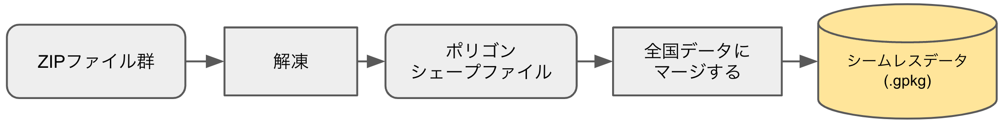

| 対象項目 | 出力ファイル               |
| ---- | -------------------- |
| 土地利用 | l03_landuse.gpkg     |
| 洪水   | a31_flood.gpkg       |
| 土砂   | a33_sediments.gpkg   |
| 津波   | a40_tsunami.gpkg     |
| 地すべり | a46_landslip.gpkg    |
| 災害危険 | a48_disaster.gpkg    |
| 高潮   | a49_storm_surge.gpkg |
| 地震   | b01_earthquake.gpkg  |
| 傾斜度  | g04_slope.gpkg |

#### 1.4.2. 竜巻
- 2種類のポイントを１つにマージ
- 500mの融合したバッファを発生させる

| 対象項目 | 出力ファイル               |
| ---- | -------------------- |
| 竜巻 | a30_tornado.gpkg     |

#### 1.4.3. 避難施設
- CSVの経度、緯度からポイントを生成する
    - CSVファイルの経度カラム名：`経度`
    - CSVファイルの緯度カラム名：`緯度`
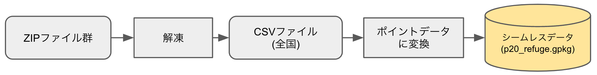

| 対象項目 | 出力ファイル               |
| ---- | -------------------- |
| 避難施設 | p20_refuge.gpkg     |

#### 1.4.4. 市区町村
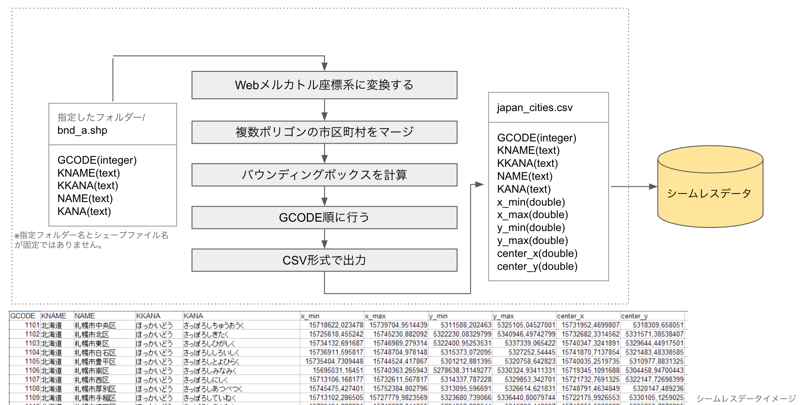

## 2. メッシュ・ワクの作成
- ワクのA1サイズ：841mm x 594mm
- メッシュIDを左上から右、その下の段の左から右、の順番に付与する

### 2.1. 作成処理フロー（市区町村指定） 
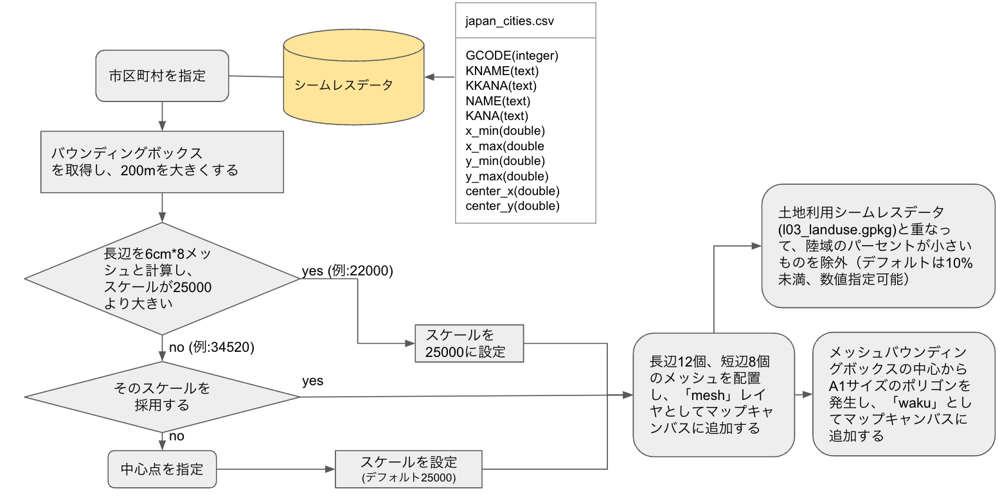
### 2.2. 作成処理フロー（中心点指定） 
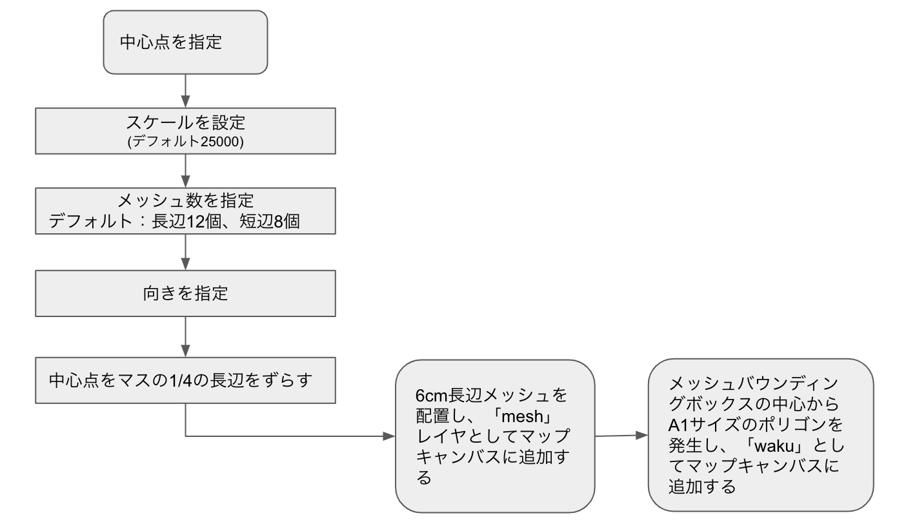
### 2.3. 履歴指定
- mesh_production_log.csvのカラム構成
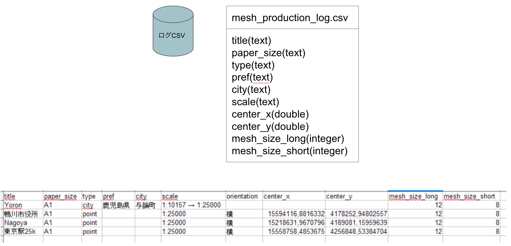
- メッシュ・ワク作成処理フロー
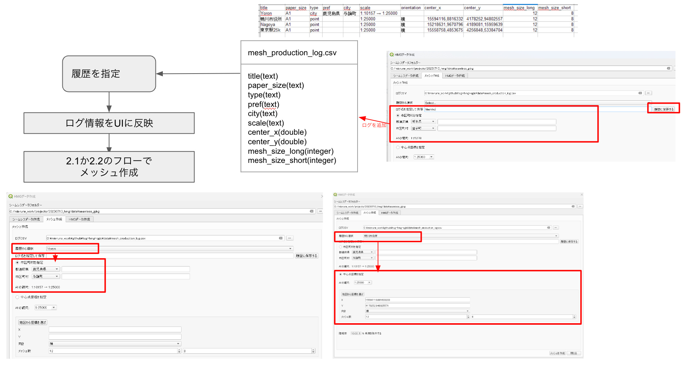
## 3. ハザードマップゲームデータ作成

### 3.1. 点数付与処理ロジック
- 「mesh_score」レイヤを作成し、シームレスデータからリスク値とランクを付与される。

| 項目   | 入力シームレスデータ           | 図形処理                 | リスク値    | 陸域の調整※1 | リスク値の属性名 | ランクの属性名※2  |
| ---- | -------------------- | -------------------- | ------- | ------- | -------- | ---------- |
| 竜巻   | a30_tornado.gpkg     | 点→500mバッファー          | 面積の合計   | ×       | tornado  | t_tornado  |
| 洪水   | a31_flood.gpkg       | 20mメッシュ→中心点          | 値の合計    | 〇       | flood    | t_flood    |
| 土砂   | a33_sediments.gpkg   |                      | 面積の合計   | 〇       | sediment | t_sediment |
| 津波   | a40_tsunami.gpkg     |                      | 面積×値の合計 | 〇       | tsunami  | t_tsunami  |
| 地すべり | a46_landslip.gpkg    |                      | 面積の合計   | 〇       | landslip | t_landslip |
| 災害危険 | a48_disaster.gpkg    |                      | 面積の合計   | 〇       | disaster | t_disaster |
| 高潮   | a49_storm_surge.gpkg |                      | 面積×値の合計 | 〇       | surge    | t_surge    |
| 地震   | b01_earthquake.gpkg  | 250mメッシュ→中心点         | 値の平均    | ×       | quake    | t_quake    |
| 傾斜度  | g04_slope.gpkg       | 250mメッシュ→中心点→土砂災害範囲外 | 値の平均    | ×       | slope    | t_slope    |
| 避難施設 | p20_refuge.gpkg      |                      | 点の数     | ×       | refuge   | t_refuge   |

##### ※1 陸域調整
- 目的: 災害の値を調整する（陸域は狭いが、その中が危険な場合に、点数が低くならないようにする）
- 調整の計算式は、`（調整後のリスク値）＝（調整前のリスク値）/（陸域のパーセント）`
- 各災害のうち割合を示す項目は値の調整は行わない、具体的には、確率的地震動予測と傾斜度
##### ※2 ランク計算ロジック
- リスク値の合計に対して、点数の低い順に設定した割合に達するまで同じ点数を付与していく
- TCG方式は、割合が固定

| リスク割合      | → | ランク | 備考                                    |
| -------------- | - | ----- | ----------------------------------- |
| リスク割合=0        | → | ランク=0 |                                     |
| 0<リスク割合=<0.1   | → | ランク=1 |                                     |
| 0.1<リスク割合=<0.3 | → | ランク=2 |                                     |
| 0.3<リスク割合=<0.5 | → | ランク=3 |                                     |
| 0.5<リスク割合=<0.7 | → | ランク=4 |                                     |
| 0.7<リスク割合=<0.9 | → | ランク=5 | ※ただし、直前のランクが4以下の場合は、0.7<リスク割合→ランク=5 |
| 0.9<リスク割合      | → | ランク=6 | ※ただし、直前のマスのランクが5だった場合のみ             |

- ※マスのリスク値が全て同じ場合には、全てのマスのランクは5になる
- ※ランクごとのマスの数は均等にはならない

### 3.2. 各種類の点数付与処理の仕様

#### 土地利用
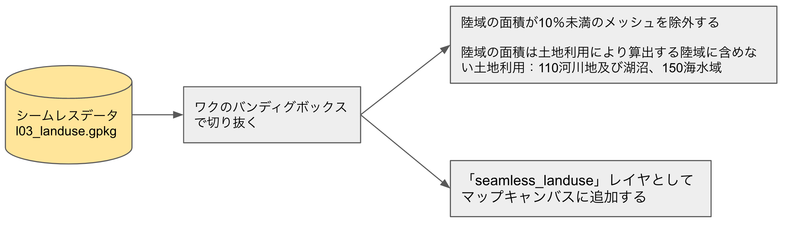
#### 竜巻
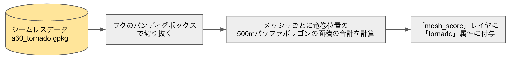
#### 洪水

#### 土砂
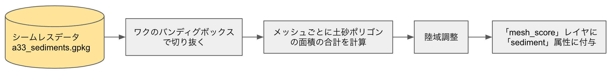
#### 地すべり
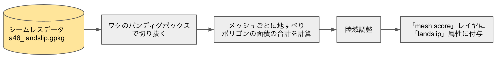
#### 災害危険
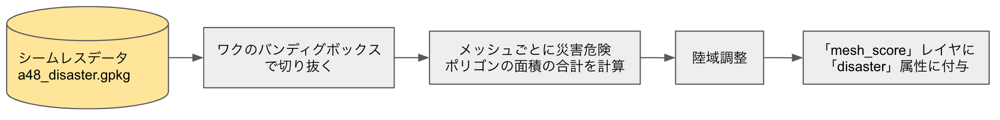
#### 津波

#### 高潮
#### 地震

#### 傾斜度

#### 避難施設

## 4. PDF

