# 概要

- この資料は処理・データの仕様をまとめている。
- このツールの処理は以下の通りである。
    1. シームレスデータ作成
    1. メッシュの作成
    1. ハザードマップゲームデータの作成
    1. PDFとシェープファイルの出力
    
    

# 1. シムレースデータ作成

## 1.1. 入力データ構成

- フォルダー名によって、各項目のフォルダーが自動的に指定される。
- 個別にフォルダーを指定することもできる。
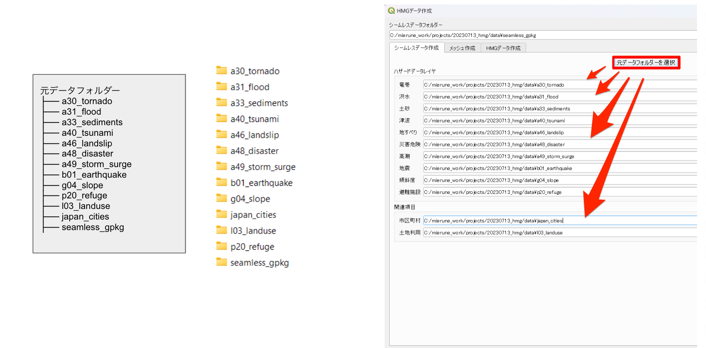

## 1.2. 入力データのダウンロードURL

- 各項目で使用するデータのダウンロードURLである。
- いずれもZIP形式でダウンロードされ、シームレスデータ作成に際し解凍は不要である。
- バージョンは2024年4月19日現在のもの。

  | コード | 項目名  | 内容           | ダウンロード先                                                                                                                                  | 備考          |
  | --- | ---- | ------------ | ---------------------------------------------------------------------------------------------------------------------------------------- | ----------- |
  | A30 | 竜巻   | 竜巻等の突風       | [https://nlftp.mlit.go.jp/ksj/gml/datalist/KsjTmplt-A30b.html](https://nlftp.mlit.go.jp/ksj/gml/datalist/KsjTmplt-A30b.html)             |             |
  | A31 | 洪水   | 洪水浸水想定区域     | [https://nlftp.mlit.go.jp/ksj/gml/datalist/KsjTmplt-A31-v2_2.html](https://nlftp.mlit.go.jp/ksj/gml/datalist/KsjTmplt-A31-v2_2.html)     |             |
  | A33 | 土砂   | 土砂災害警戒区域     | [https://nlftp.mlit.go.jp/ksj/gml/datalist/KsjTmplt-A33-v1_4.html](https://nlftp.mlit.go.jp/ksj/gml/datalist/KsjTmplt-A33-v1_4.html)     |             |
  | A40 | 津波   | 津波浸水想定区域     | [https://nlftp.mlit.go.jp/ksj/gml/datalist/KsjTmplt-A40-v2_1.html](https://nlftp.mlit.go.jp/ksj/gml/datalist/KsjTmplt-A40-v2_1.html)     |             |
  | A46 | 地すべり | 地すべり防止区域     | [https://nlftp.mlit.go.jp/ksj/gml/datalist/KsjTmplt-A46-v1_1.html](https://nlftp.mlit.go.jp/ksj/gml/datalist/KsjTmplt-A46-v1_1.html)     |             |
  | A48 | 災害危険 | 災害危険区域       | [https://nlftp.mlit.go.jp/ksj/gml/datalist/KsjTmplt-A48-v1_1.html](https://nlftp.mlit.go.jp/ksj/gml/datalist/KsjTmplt-A48-v1_1.html)     |             |
  | A49 | 高潮   | 高潮浸水想定区域     | [https://nlftp.mlit.go.jp/ksj/gml/datalist/KsjTmplt-A49-v1_1.html](https://nlftp.mlit.go.jp/ksj/gml/datalist/KsjTmplt-A49-v1_1.html)     | 東京都のみ       |
  | B01 | 地震   | 確率論的地震動予測地図  | [https://www.j-shis.bosai.go.jp/map/JSHIS2/download.html?lang=jp](https://www.j-shis.bosai.go.jp/map/JSHIS2/download.html?lang=jp)       | 2021年、最大ケース |
  | P20 | 避難所  | 避難施設         | [https://www.gsi.go.jp/bousaichiri/hinanbasho.html#info2](https://www.gsi.go.jp/bousaichiri/hinanbasho.html#info2)                       |             |
  | G04 | 傾斜度  | 標高・傾斜度5次メッシュ | [https://nlftp.mlit.go.jp/ksj/gml/datalist/KsjTmplt-G04-d.html](https://nlftp.mlit.go.jp/ksj/gml/datalist/KsjTmplt-G04-d.html)           |             |
  | L03 | 土地利用 | 土地利用細分メッシュ   | [https://nlftp.mlit.go.jp/ksj/gml/datalist/KsjTmplt-L03-b-v3_1.html](https://nlftp.mlit.go.jp/ksj/gml/datalist/KsjTmplt-L03-b-v3_1.html) |

## 1.3. 出力データ構成

下記のファイル名と合致するファイルが存在しない場合、該当の災害データの作成処理はスキップされる。
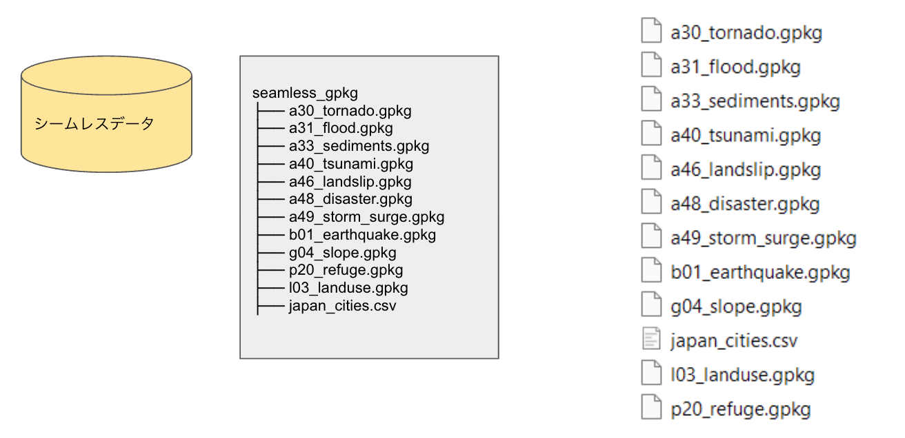

## 1.4. シームレスデータ作成処理の仕様
### 1.4.1. ポリゴン系の項目

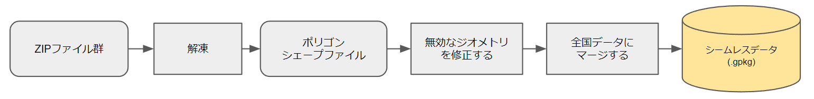

| 対象項目 | 出力ファイル               |
| ---- | -------------------- |
| 土地利用 | l03_landuse.gpkg     |
| 洪水   | a31_flood.gpkg       |
| 土砂   | a33_sediments.gpkg   |
| 津波   | a40_tsunami.gpkg     |
| 地すべり | a46_landslip.gpkg    |
| 災害危険 | a48_disaster.gpkg    |
| 高潮   | a49_storm_surge.gpkg |
| 地震   | b01_earthquake.gpkg  |
| 傾斜度  | g04_slope.gpkg |

### 1.4.2. 竜巻

- 2種類のポイントを１つにマージする。
- 500mの融合したバッファを生成する。
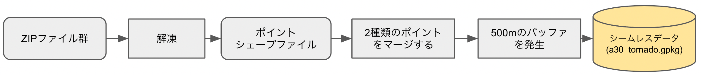

| 対象項目 | 出力ファイル               |
| ---- | -------------------- |
| 竜巻 | a30_tornado.gpkg     |

### 1.4.3. 避難施設

- CSVの経度、緯度からポイントを生成する。
    - CSVファイルの経度カラム名：`経度`
    - CSVファイルの緯度カラム名：`緯度`

| 対象項目 | 出力ファイル               |
| ---- | -------------------- |
| 避難施設 | p20_refuge.gpkg     |

### 1.4.4. 市区町村

# 2. 枠・メッシュの作成

- 枠はA1サイズ（841mm x 594mm）で作成される。
- メッシュにIDを左上から右、上から下の順番に付与する。

## 2.1. 作成処理フロー（市区町村指定） 

## 2.2. 作成処理フロー（中心点指定） 

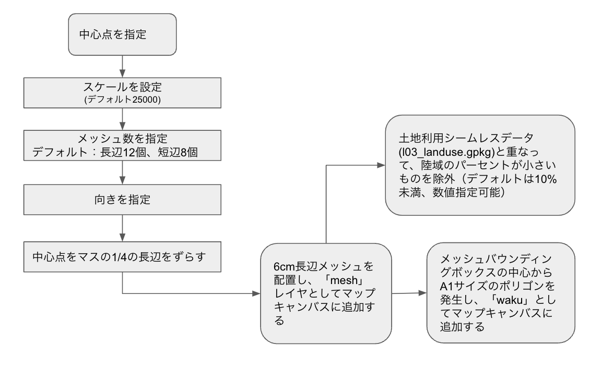

## 2.3. 履歴指定

- mesh_production_log.csvのカラム構成

- メッシュ・ワク作成処理フロー

# 3. ハザードマップゲームデータ作成

## 3.1. 点数付与処理ロジック

- 「mesh_score」レイヤを作成し、シームレスデータからリスク値とそれに応じたランクを付与される。

  | 項目   | 入力シームレスデータ           | 図形処理                 | リスク値    | 陸域の調整※1 | リスク値の属性名 | ランクの属性名※2  |
  | ---- | -------------------- | -------------------- | ------- | ------- | -------- | ---------- |
  | 竜巻   | a30_tornado.gpkg     | 点→500mバッファー          | 面積の合計   | ×       | tornado  | t_tornado  |
  | 洪水   | a31_flood.gpkg       | 20mメッシュ→中心点          | 値の合計    | 〇       | flood    | t_flood    |
  | 土砂   | a33_sediments.gpkg   |                      | 面積の合計   | 〇       | sediment | t_sediment |
  | 津波   | a40_tsunami.gpkg     |                      | 面積×値の合計 | 〇       | tsunami  | t_tsunami  |
  | 地すべり | a46_landslip.gpkg    |                      | 面積の合計   | 〇       | landslip | t_landslip |
  | 災害危険 | a48_disaster.gpkg    |                      | 面積の合計   | 〇       | disaster | t_disaster |
  | 高潮   | a49_storm_surge.gpkg |                      | 面積×値の合計 | 〇       | surge    | t_surge    |
  | 地震   | b01_earthquake.gpkg  | 250mメッシュ→中心点         | 値の平均    | ×       | quake    | t_quake    |
  | 傾斜度  | g04_slope.gpkg       | 250mメッシュ→中心点→土砂災害範囲外 | 値の平均    | ×       | slope    | t_slope    |
  | 避難施設 | p20_refuge.gpkg      |                      | 点の数     | ×       | refuge   | t_refuge   |

### ※1 陸域調整

- 狭域の陸域の危険性が高い場合に、マス自体のリスク値が低くならないよう、災害の値を調整することを目的としている。
- 調整の計算式は、`（調整後のリスク値）＝（調整前のリスク値）/（陸域のパーセント）` となっている。
- 各災害のうち割合を示す項目は値の調整は行わない、具体的には、確率的地震動予測と傾斜度のみを対象としている。

### ※2 ランク計算ロジック

- リスク値の合計に対して、点数の低い順に設定した割合に達するまで同じ点数を付与していく処理である。
- TCG方式は、割合を固定している。

  | リスク割合      | → | ランク | 備考                                    |
  | -------------- | - | ----- | ----------------------------------- |
  | リスク割合=0        | → | ランク=0 |                                     |
  | 0<リスク割合=<0.1   | → | ランク=1 |                                     |
  | 0.1<リスク割合=<0.3 | → | ランク=2 |                                     |
  | 0.3<リスク割合=<0.5 | → | ランク=3 |                                     |
  | 0.5<リスク割合=<0.7 | → | ランク=4 |                                     |
  | 0.7<リスク割合=<0.9 | → | ランク=5 | ※ただし、直前のランクが4以下の場合は、0.7<リスク割合→ランク=5 |
  | 0.9<リスク割合      | → | ランク=6 | ※ただし、直前のマスのランクが5だった場合のみ             |

- マスのリスク値が全て同じ場合には、全てのマスのランクは5と設定される。
- ランクごとのマスの数は均等にはならない。
- 合計点数が同じ枠が複数ある場合には、同じランクとなるよう設定される。

## 3.2. 各種類の点数付与処理の仕様

### 土地利用

### 竜巻

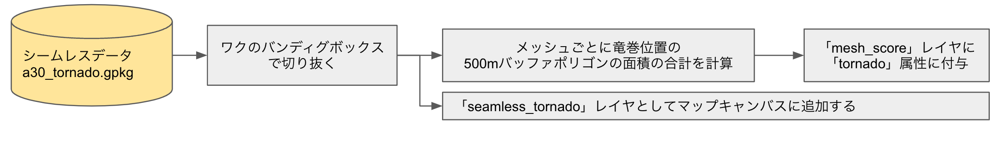

### 洪水

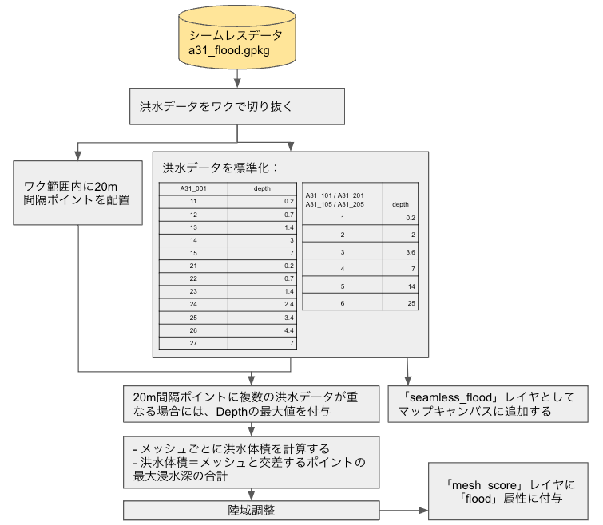

- 洪水値計算の標準化の仕様を変更する場合
  - プラグイン設定ファイルの条件を編集
  - プラグインフォルダー先 : C:\Users\USER\AppData\Roaming\QGIS\QGIS3\profiles\default\python\plugins\tcg-hmg-qgis
  - [コード先： tcg-hmg-qgis/converter/seamless2hmg.py #L367](https://github.com/MIERUNE/tcg-hmg-qgis/blob/main/converter/seamless2hmg.py#L367)
  - 例えば下記フォーマットで条件が定められているので、必要に応じて追加・変更を行う。
    - `f"WHEN {field} = 7 THEN 35 "`

### 土砂

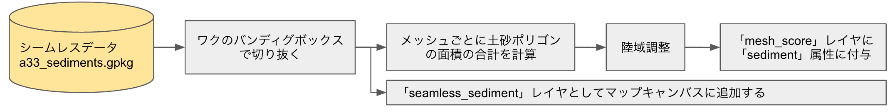

### 地すべり

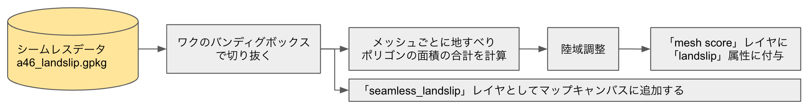

### 災害危険

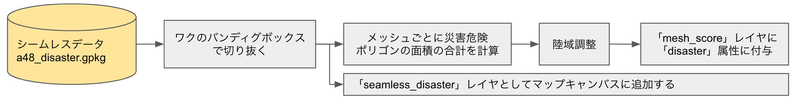

### 津波

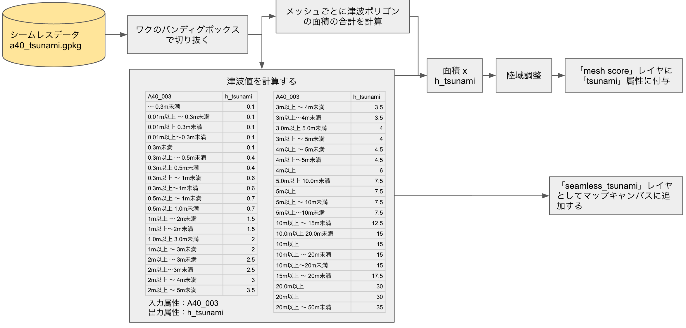

- 津波値計算の仕様を変更する場合
  - プラグイン設定ファイルの条件を編集
  - プラグインフォルダー先 : C:\Users\USER\AppData\Roaming\QGIS\QGIS3\profiles\default\python\plugins\tcg-hmg-qgis
  - [コード先： tcg-hmg-qgis/converter/seamless2hmg.py #L693](https://github.com/MIERUNE/tcg-hmg-qgis/blob/main/converter/seamless2hmg.py#L693)
  - 例えば下記フォーマットで条件が定められているので、必要に応じて追加・変更を行う。
    - `sql += f"WHEN \"{height}\" = '40m以上 〜 50m未満' THEN 45 "`

### 高潮

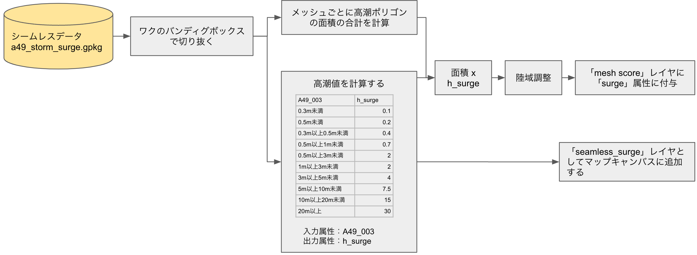

- 高潮値計算の仕様を変更する場合
  - プラグイン設定ファイルの条件を編集
  - プラグインフォルダー先 : C:\Users\USER\AppData\Roaming\QGIS\QGIS3\profiles\default\python\plugins\tcg-hmg-qgis
  - [コード先： tcg-hmg-qgis/converter/seamless2hmg.py #L804](https://github.com/MIERUNE/tcg-hmg-qgis/blob/main/converter/seamless2hmg.py#L804)
  - 例えば下記フォーマットで条件が定められているので、必要に応じて追加・変更を行う。
    - `sql += f"WHEN \"{height}\" = '40m以上 〜 50m未満' THEN 45 "`

### 地震

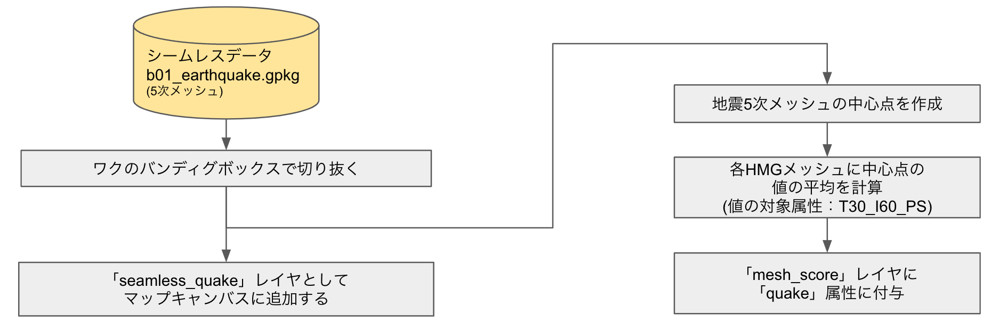

### 傾斜度

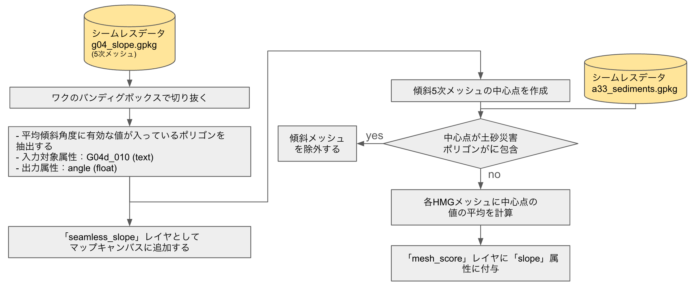

### 避難施設

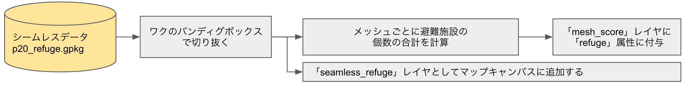

## 4. PDFとSHP出力

- 出力はマップのエクスポートでA1サイズ、解像度300DPIのPDFで出力される。
- HMGデータから背景地図やラベルレイヤが生成され、出力に使用される。

## 4.1. 追加レイヤ

### ラベル

| レイヤ名         | 内容         | 色             | フォント                  | サイズ  | バッファ    | 対象属性   | 位置                          |
| ------------ | ---------- | ------------- | --------------------- | ---- | ------- | ------ | --------------------------- |
| label_id     | タイル番号      | #686868 (グレー) | Arial Rounded MT Bold | 26pt | 1.5mm 白 | id     | メッシュの中心点                    |
| label_score  | タイルのハザード点数 | #ff0000 (赤)   | Arial Rounded MT Bold | 26pt | 1.5mm 白 | 4.2に参考    | メッシュの中心点からメッシュの1/5の長辺を下へずらす |
| label_refuge | タイル内の避難所数  | #0070ff (緑)   | Arial Rounded MT Bold | 26pt | 1.5mm 白 | refuge | メッシュの中心点からメッシュの1/5の長辺を上へずらす |

### 背景地図

| レイヤ名              | タイルURL                                                            |
| ----------------- | ----------------------------------------------------------------- |
| basemap_standard  | https://cyberjapandata.gsi.go.jp/xyz/std/{z}/{x}/{y}.png          |
| basemap_relief    | https://cyberjapandata.gsi.go.jp/xyz/relief/{z}/{x}/{y}.png       |
| basemap_hillshade | https://cyberjapandata.gsi.go.jp/xyz/hillshademap/{z}/{x}/{y}.png |

### 点数合計ランク

- 出力項目でチェックした項目の災害点数を合計し、3段階のランクに分けて色別の円を表示する。
- レイヤ名：hazard_score
- 災害点数の合計の属性名 : hazard
- ランクの属性名：rank
- ランクの分け方：
    - 色分けは３段階で固定され、「黄色」「オレンジ」「赤」となっている。
    - 全ての枠の合計点数を総合計を求める。
    - 合計点数が小さい順に並べて、順番によって円の色を決める。
      - 全体の上位50％未満：黄色
      - 全体の上位50％以上80％未満：オレンジ
      - 全体の上位80％以上：赤
      - ※ 合計点数が同じ枠が複数ある場合には、同じ色になるようにする。

## 4.2. 各種PDFの仕様

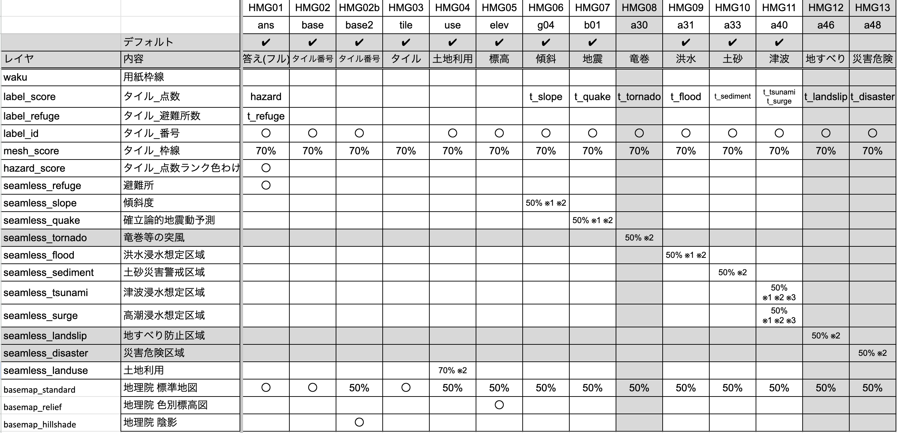

- ※1　シンボル数値分類クラス10を都度設定する項目
- ※2　描画モード：乗算（Multiply）
- ※3　東京都の津波浸水想定の代わり

### 避難所のシンボル仕様

- 対象レイヤ：seamless_refuge
- マーカーサイズ : 5mm
- マーカーSVGの出典：[避難口誘導灯 (ISO 7010)](https://en.m.wikipedia.org/wiki/File:Emergency_Exit_ISO_Pictogram_(green).svg)

### シングルシンボルで設定項目

| レイヤ名              | 色       | アウトライン        |
| ----------------- | ------- | ------------- |
| seamless_tornado  | #FF0000 | #686868 0.1mm |
| seamless_sediment | #FF0000 | #686868 0.1mm |
| seamless_landslip | #FF0000 | #686868 0.1mm |
| seamless_disaster | #FF0000 | #686868 0.1mm |

### 数値分類クラス10を都度設定項目

| レイヤ名             | 対象属性       | 最低値の色   | 最大値の色   |
| ---------------- | ---------- | ------- | ------- |
| seamless_slope   | angle      | #e8dea3 | #65411f |
| seamless_quake   | T30_I60_PS | #ffc7f0 | #dc00e4 |
| seamless_flood   | depth      | #aa95c8 | #3f007d |
| seamless_tsunami | h_tsunami  | #bcaed5  | #3f007d |
| seamless_surge   | h_surge    | #bcaed5  | #3f007d |

- 値の条件に応じた色の仕様を変更する場合
  - プラグインの設定ファイルの色コードを編集
  - プラグインフォルダー先 : C:\Users\USER\AppData\Roaming\QGIS\QGIS3\profiles\default\python\plugins\tcg-hmg-qgis
  - [コード先： tcg-hmg-qgis/converter/hmg2pdf.py #L590](https://github.com/MIERUNE/tcg-hmg-qgis/blob/2c5f703820dae254ff4a0b2deeee6b5e51376047/converter/hmg2pdf.py#L590) 
  - 例：下記のように色コードを変更する。
    - 変更前 ： `seamless_lyr, f"h_{target_field}", 10, "#bcaed5", "#3f007d"`
    - 変更後 ： `seamless_lyr, f"h_{target_field}", 10, "#ffc7f0", "#dc00e4"`

### 土地利用の色設定

- 対象レイヤ：seamless_landuse

| 「土地利用種」の値 | 内容      | 色       |
| ----- | ------- | ------- |
| 0100   | 田       | #ffff00 |
| 0200   | その他の農用地 | #ffcc99 |
| 0500   | 森林      | #00aa00 |
| 0600   | 荒地      | #ff9900 |
| 0700   | 建物用地    | #ff0000 |
| 0901   | 道路      | #8c8c8c |
| 0902   | 鉄道      | #b4b4b4 |
| 1000  | その他の用地  | #c8460f |
| 1100  | 河川地及び湖沼 | #0000ff |
| 1400  | 海浜      | #ffff99 |
| 1500  | 海水域     | #00ccff |
| 1600  | ゴルフ場    | #00ff00 |
| 0000     | 不明      | #e8e8e8 |

## 4.3. 出力処理フロー

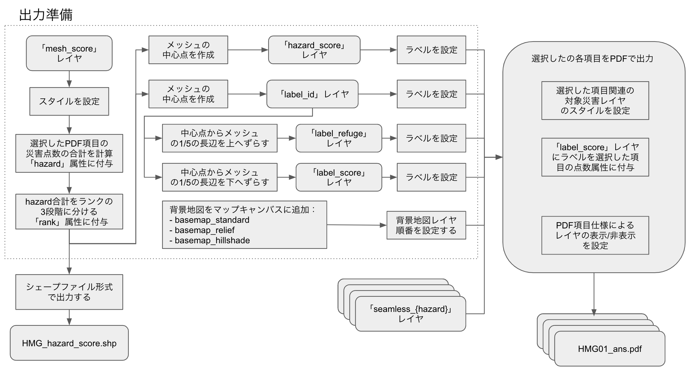

## 4.4. 出力PDFの事例

  - HMG01_ans : 災害点数合計と避難所数

    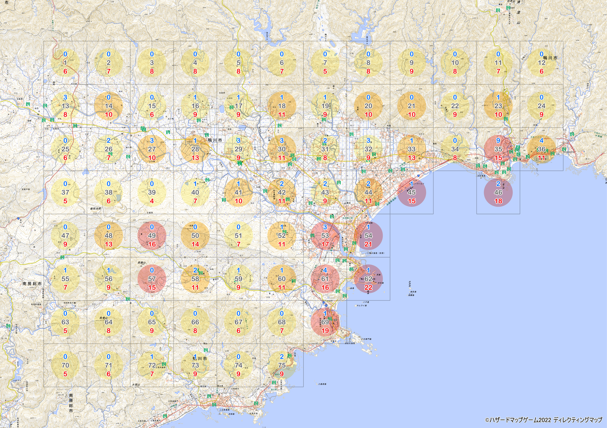

  - HMG02_base : タイル番号のみ

    

  - HMG02b_base2 : 地理院陰影地図が重なるタイル番号
  
    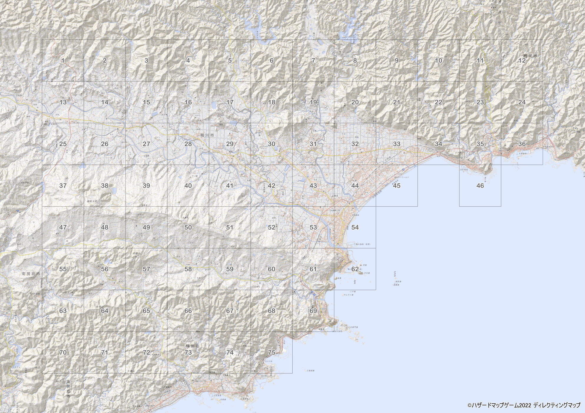
  
  - HMG03_tile : タイルのみ（番号なし）
  
    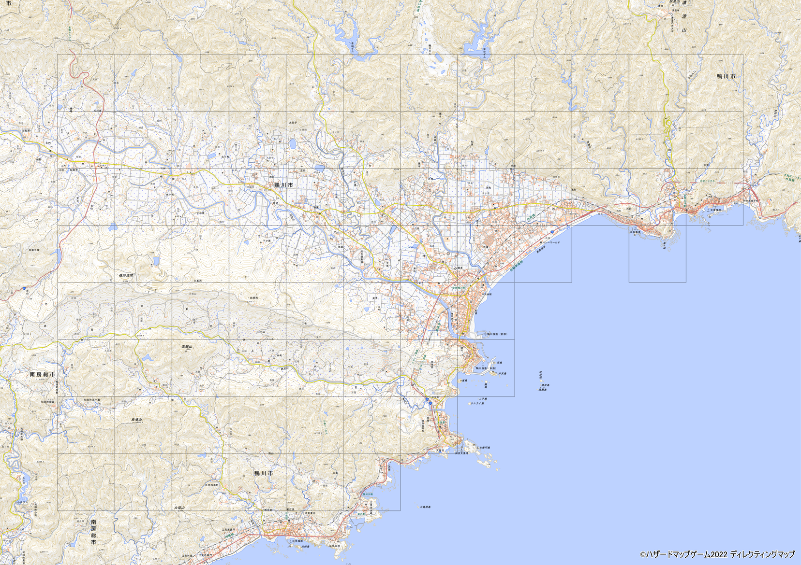
  
  - HMG04_use : 土地利用 
  
    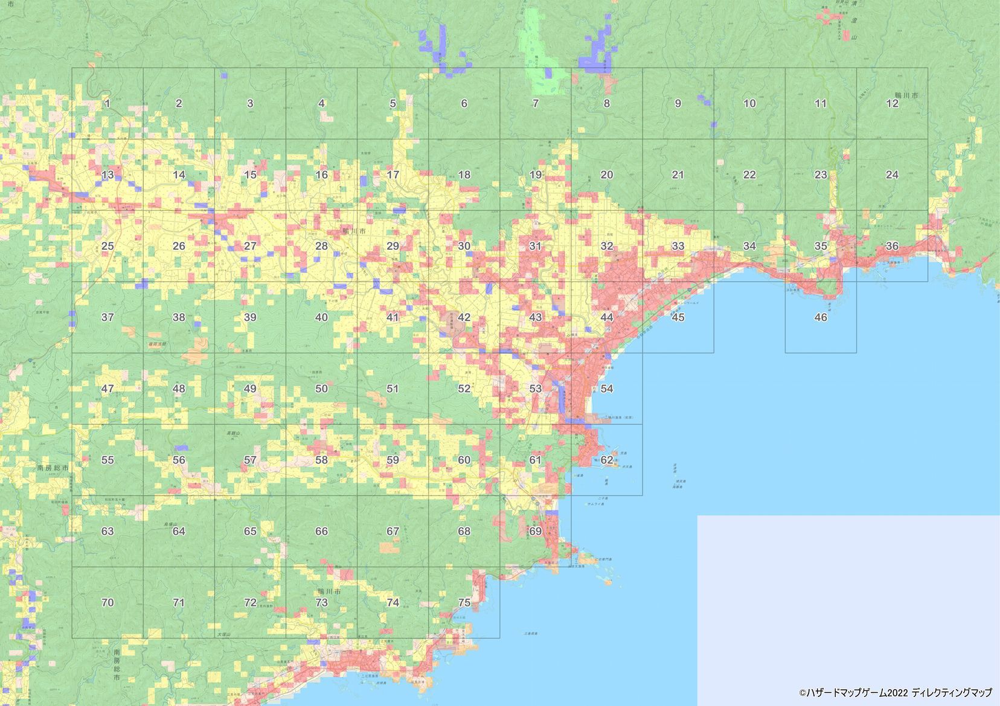
  
  - HMG05_elev : 地理院標高地図が重なるタイル番号
  
    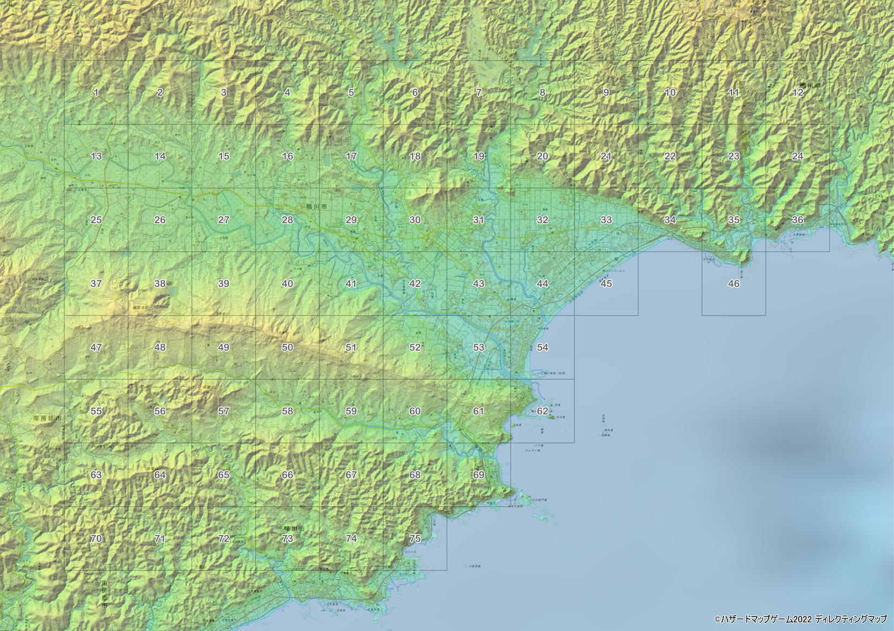
  
  - HMG06_g04 : 傾斜
  
    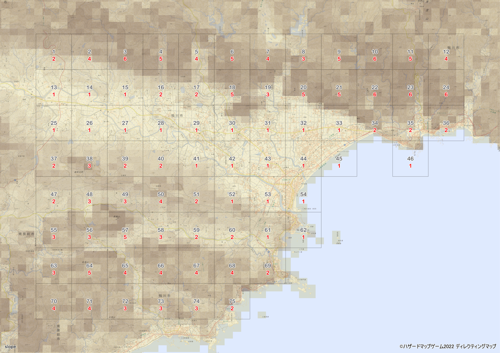
  
  - HMG07_b01 : 地震
  
    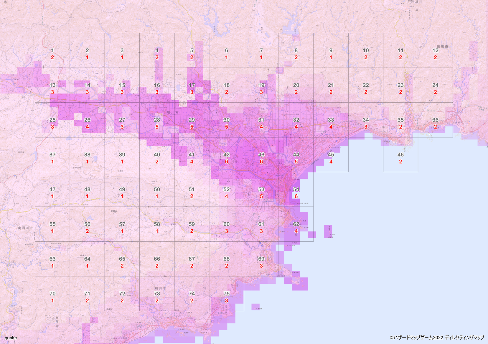
  
  - HMG08_a30 : 竜巻
  
    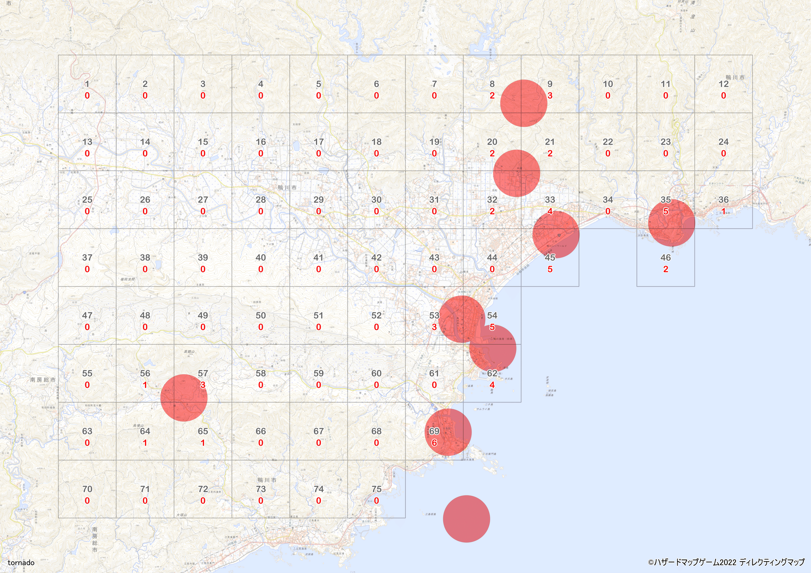
  
  - HMG09_a31 : 洪水
  
    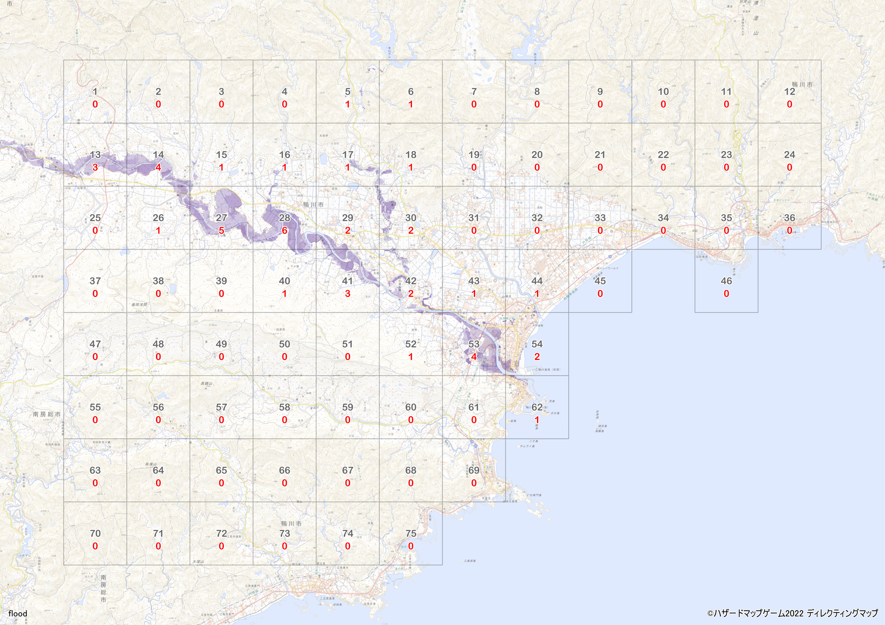
  
  - HMG10_a33 : 土砂
  
    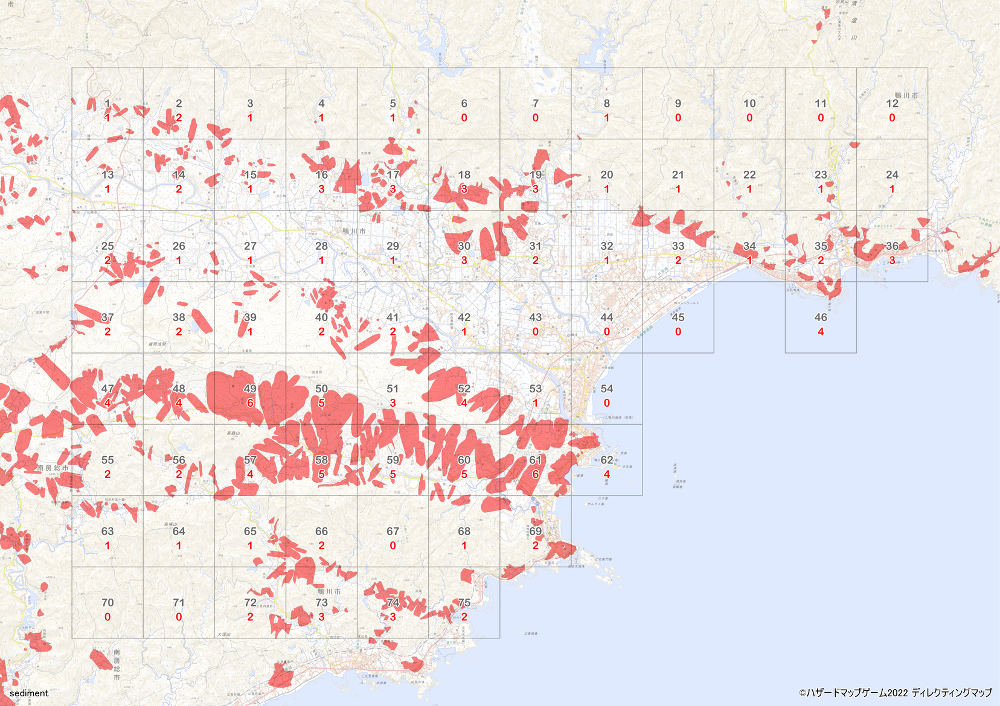
  
  - HMG11_a40 : 津波か高潮
  
    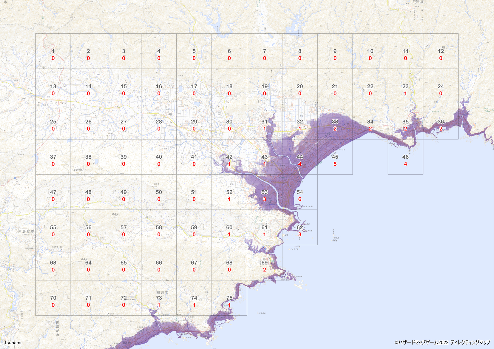
  
  - HMG12_a46 : 地すべり
  
    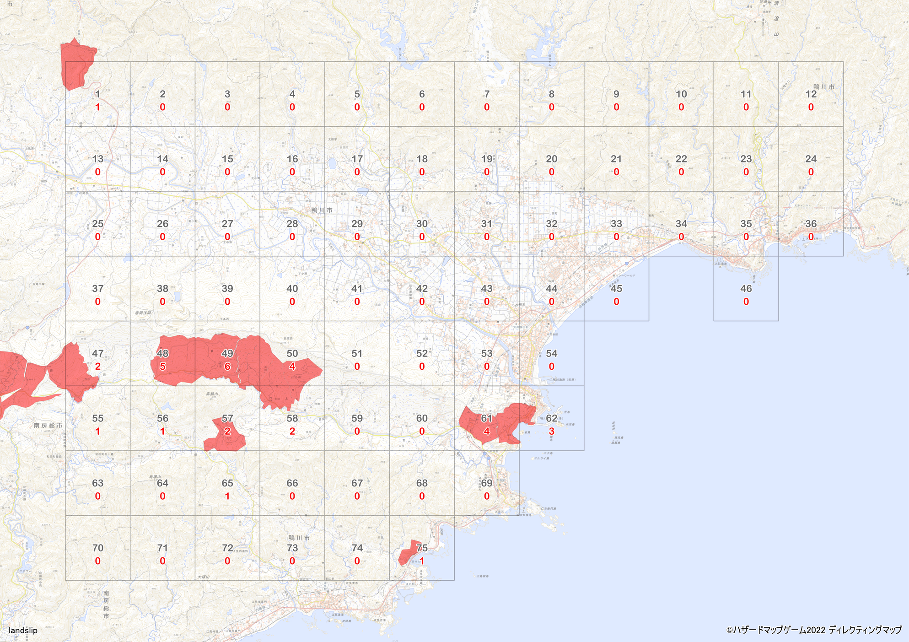
  
  - HMG13_a48 : 災害危険

    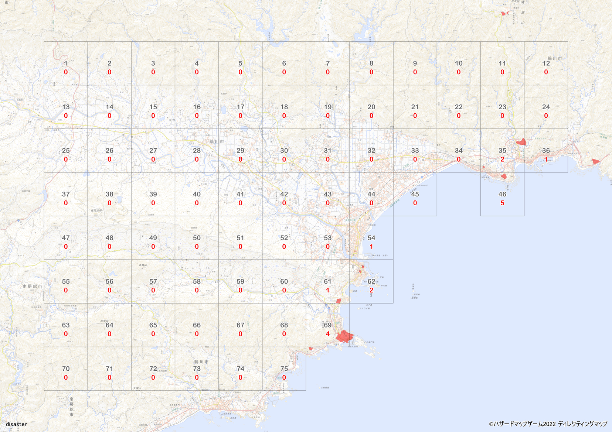