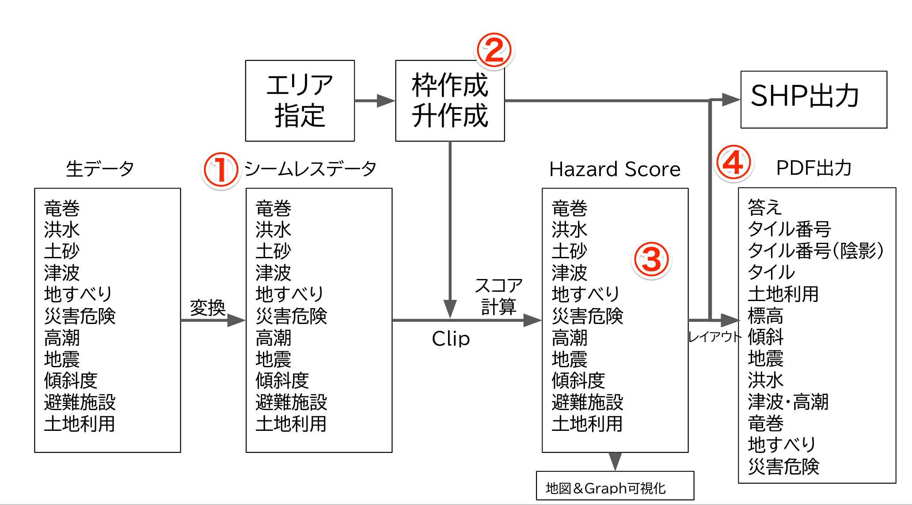

このツールの処理を4つに分かれる：
- ① シームレスデータ作成
- ② メッシュの作成
- ③ ハザードマップゲームデータの作成
- ④ PDFとシェープファイルの出力

## 1. シムレースデータ作成

### 入力データ構成

フォルダー構成によって、各項目が自動的に指定される。
フォルダー名を変更可能が、UIに個別で指定必要がある。

### 入力データのダウンロードURL
各項目の参考なダウンロードURL。
バージョンが変わる可能性がある。
ZIP形式で上記のフォルダーへダウンロードし、解凍が不要。

| コード | 項目名  | 内容           | ダウンロード先                                                                                                                                  | 備考          |
| --- | ---- | ------------ | ---------------------------------------------------------------------------------------------------------------------------------------- | ----------- |
| A30 | 竜巻   | 竜巻等の突風       | [https://nlftp.mlit.go.jp/ksj/gml/datalist/KsjTmplt-A30b.html](https://nlftp.mlit.go.jp/ksj/gml/datalist/KsjTmplt-A30b.html)             |             |
| A31 | 洪水   | 洪水浸水想定区域     | [https://nlftp.mlit.go.jp/ksj/gml/datalist/KsjTmplt-A31-v2_2.html](https://nlftp.mlit.go.jp/ksj/gml/datalist/KsjTmplt-A31-v2_2.html)     |             |
| A33 | 土砂   | 土砂災害警戒区域     | [https://nlftp.mlit.go.jp/ksj/gml/datalist/KsjTmplt-A33-v1_4.html](https://nlftp.mlit.go.jp/ksj/gml/datalist/KsjTmplt-A33-v1_4.html)     |             |
| A40 | 津波   | 津波浸水想定区域     | [https://nlftp.mlit.go.jp/ksj/gml/datalist/KsjTmplt-A40-v2_1.html](https://nlftp.mlit.go.jp/ksj/gml/datalist/KsjTmplt-A40-v2_1.html)     |             |
| A46 | 地すべり | 地すべり防止区域     | [https://nlftp.mlit.go.jp/ksj/gml/datalist/KsjTmplt-A46-v1_1.html](https://nlftp.mlit.go.jp/ksj/gml/datalist/KsjTmplt-A46-v1_1.html)     |             |
| A48 | 災害危険 | 災害危険区域       | [https://nlftp.mlit.go.jp/ksj/gml/datalist/KsjTmplt-A48-v1_1.html](https://nlftp.mlit.go.jp/ksj/gml/datalist/KsjTmplt-A48-v1_1.html)     |             |
| A49 | 高潮   | 高潮浸水想定区域     | [https://nlftp.mlit.go.jp/ksj/gml/datalist/KsjTmplt-A49-v1_1.html](https://nlftp.mlit.go.jp/ksj/gml/datalist/KsjTmplt-A49-v1_1.html)     | 東京都のみ       |
| B01 | 地震   | 確率論的地震動予測地図  | [https://www.j-shis.bosai.go.jp/map/JSHIS2/download.html?lang=jp](https://www.j-shis.bosai.go.jp/map/JSHIS2/download.html?lang=jp)       | 2021年、最大ケース |
| P20 | 避難所  | 避難施設         | [https://www.gsi.go.jp/bousaichiri/hinanbasho.html#info2](https://www.gsi.go.jp/bousaichiri/hinanbasho.html#info2)                       |             |
| G04 | 傾斜度  | 標高・傾斜度5次メッシュ | [https://nlftp.mlit.go.jp/ksj/gml/datalist/KsjTmplt-G04-d.html](https://nlftp.mlit.go.jp/ksj/gml/datalist/KsjTmplt-G04-d.html)           |             |
| L03 | 土地利用 | 土地利用細分メッシュ   | [https://nlftp.mlit.go.jp/ksj/gml/datalist/KsjTmplt-L03-b-v3_1.html](https://nlftp.mlit.go.jp/ksj/gml/datalist/KsjTmplt-L03-b-v3_1.html) |
#### 1.2.2 ハザードマップゲームデータ作成
- メッシュ・ワクの作成
- 点数付与処理

#### 1.2.3 出力
- shapefileの出力
- PDFの出力

## 2. 計算処理の仕様
### 2.1 シムレースデータ作成
#### 土地利用
#### 竜巻
#### 洪水
#### 土砂
#### 津波
#### 地すべり
#### 災害危険
#### 高潮
#### 地震
#### 傾斜度
#### 避難施設

### 2.2 ハザードマップゲームデータ作成
#### 2.2.1 メッシュ・ワクの作成
#### 2.2.2 点数付与処理

